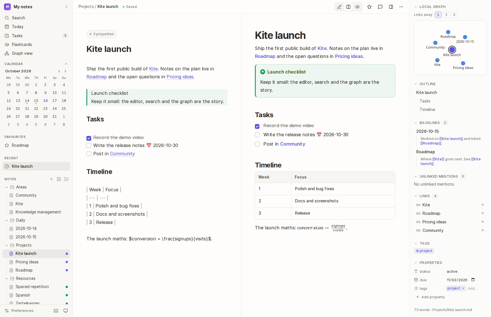
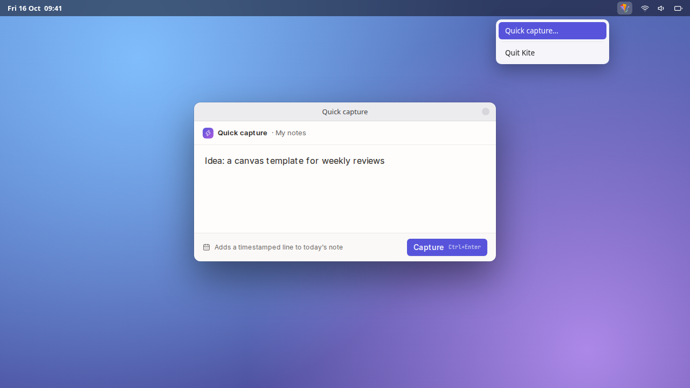
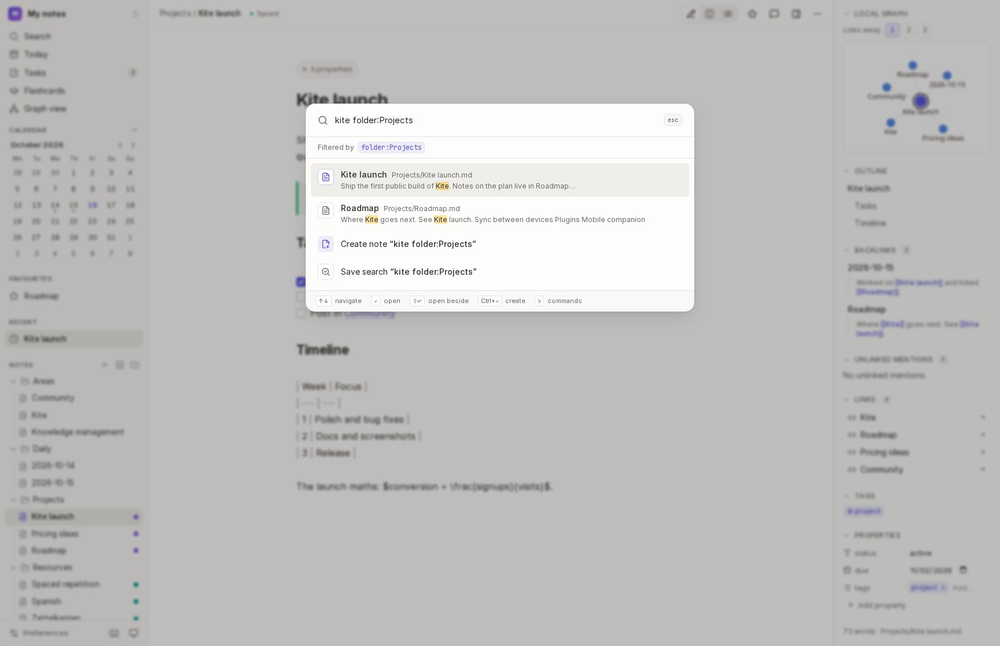
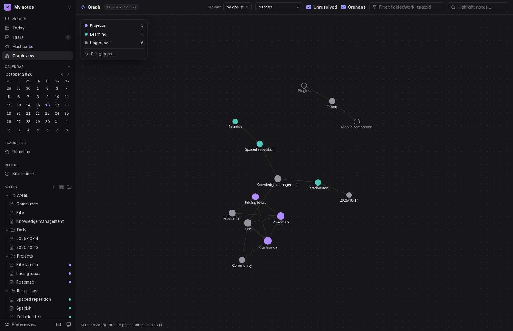
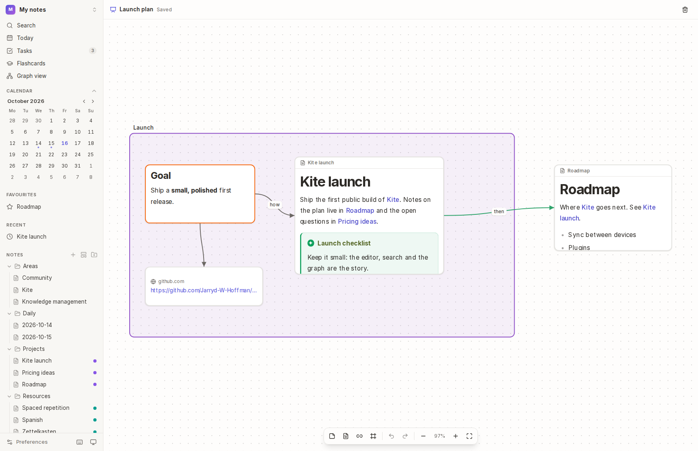
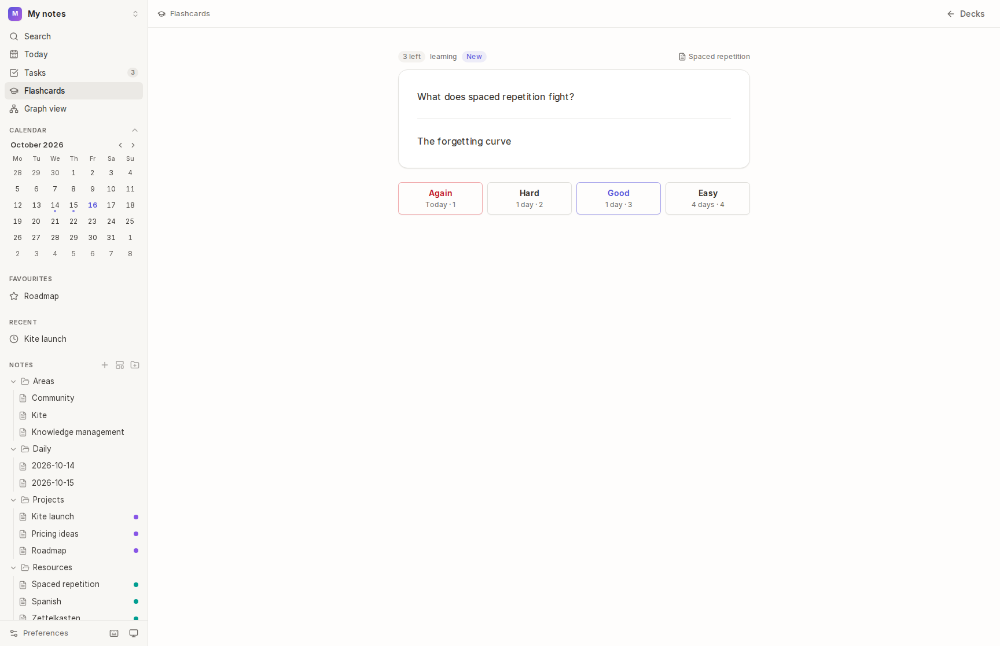
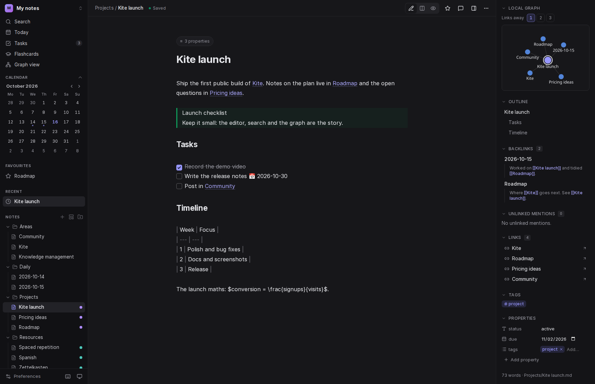

<h1 align="center">🪁 Kite</h1>

<p align="center">
    <strong>A local-first desktop app for Markdown notes and the links between them.</strong><br>
    Your notes stay plain <code>.md</code> files in a folder you own. Kite adds search, links, a graph,<br>
    canvases, flashcards and more, without ever locking them in.
</p>

<p align="center">
    <a href="https://github.com/Jarryd-W-Hoffman/kite/actions/workflows/tests.yml"></a>
    
    
    
</p>

<p align="center">
    
</p>

---

## Why Kite?

- **Your files, your folder.** A vault is just a folder of Markdown. Open it in any editor, sync it however you like, keep it in Git. Kite never moves your notes into a database it owns.
- **Links first.** Type `[[` to link notes. Backlinks, unlinked mentions, a live graph and link-aware renames keep a web of notes easy to work with.
- **Fast, even when big.** Full-text search, filters and the sidebar stay quick in vaults of 10,000 notes and more, and CI [checks it](#development) on every change.
- **Private by default.** Everything runs on your computer. Notes can be locked with a passphrase and are encrypted on disk. Crash reports are off unless you turn them on, and never include your notes.

## Features

### ✍️ Writing
- **Editor:** a CodeMirror editor with **live preview**: headings, emphasis, links, checkboxes and images look like they will read, as you type.
- **Views:** edit, split or preview, plus **focus mode**, **tabs** and a **second pane** to open notes side by side.
- **Slash commands:** `/` for headings, lists, tables, code, math, diagrams, dates and links.
- **Rich Markdown:**
  - callouts (`> [!tip]`)
  - math (KaTeX)
  - Mermaid diagrams
  - tables and task lists
  - embedded notes and sections (`![[Note#Heading]]`)
- **Attachments:** paste or drop images and files into a note.
- **Properties:** frontmatter edited as typed properties (text, number, checkbox, date, list).
- **Templates** with `{{title}}`, `{{date}}`, `{{date:D j M}}` and `{{time}}`.
- **Daily notes:** a calendar of your daily notes, one click to today's, and [quick capture](#-quick-capture) from anywhere.

### ⚡ Quick capture

Jot down a thought without switching to Kite. A small window pops up over whatever you're doing, and what you type is added to today's note as a timestamped line.

- **From anywhere:** press <kbd>Ctrl</kbd>+<kbd>Shift</kbd>+<kbd>Space</kbd> (<kbd>⌘</kbd>+<kbd>Shift</kbd>+<kbd>Space</kbd> on macOS), even when Kite is in the background. You can change the shortcut, or turn it off, in **Preferences → Quick capture**.
- **From the tray icon:** Kite puts a kite icon in the system tray (the menu bar on macOS). Click it and choose **Quick capture…**.
- **Saving:** press <kbd>Mod</kbd>+<kbd>Enter</kbd> to add it, or <kbd>Esc</kbd> to close the window. Captures go to the vault you opened most recently.

<p align="center">
    
</p>

### 🔗 Connecting
- **Links:** wiki links (`[[Note]]`, `[[Note#Heading]]`, `[[Note|alias]]`) that are rewritten when you rename or move a note.
- **Block links:** end a paragraph or list item with `^an-id` (or use **Copy link to this block**) to link to it with `[[Note#^an-id]]`, or embed just that block with `![[Note#^an-id]]`.
- **Backlinks and unlinked mentions:** see everything that links to a note, and which heading or block each link points at, or mentions it without linking, and link it in a click.
- **Tags:** inline `#tags` or in frontmatter, with nested tags like `#area/work`.
- **Refactoring:** extract a selection into a new note, or merge notes together.
- **Colour groups:** colour notes by a query, in the graph and the file tree.

### 🔎 Finding
- **Command palette (`Mod+K`):** search every note, run any command, or create a note from what you typed.
- **Search filters** combine with text:
  - `tag:project`
  - `folder:Work`
  - `-tag:archived`
  - any property, e.g. `status:done`
- **Saved searches:** keep a search in the sidebar; its results stay up to date.
- **Table and board views:** your notes as a sortable table of their properties, or a board grouped by one of them.
- **Tasks:** every task in the vault in one place, with due dates (`📅 2026-10-30`).

<p align="center">
    
    
</p>

### 🕸️ Seeing
- **Graph view:**
  - every note and link, coloured by folder, tag or colour group
  - filters in the same language as search
  - toggles for orphans and unresolved links
- **Local graph:** each note's neighbourhood, 1 to 3 links away.

<p align="center">
    
</p>

- **Canvases:** a whiteboard of text, note, image and link cards, grouped and connected. Saved as open [JSON Canvas](https://jsoncanvas.org) files that Obsidian can open too.

<p align="center">
    
</p>

### 🧠 Learning
Turn what you write into quiz cards. Kite shows each card again just before you'd forget it (spaced repetition, as in Anki).

- **Writing cards:** tag a note `#flashcards`, then write cards anywhere in it:

  ```markdown
  #flashcards/french

  Capital of France :: Paris
  le chien ::: the dog
  The ==Eiffel Tower== was finished in 1889.
  ```

  | You write | You get |
  | --- | --- |
  | `Question :: Answer` | one card |
  | `word ::: translation` | two cards, one asked each way |
  | `==highlighted==` text | a fill-in-the-blank card for each highlight |
  | question lines, a `?` line, answer lines | a longer card, ending at a blank line |

- **Decks** come from the tag: `#flashcards/french` goes in the "french" deck, and plain `#flashcards` in "General".
- **Studying:** open **Flashcards** in the sidebar, recall the answer, then rate it **Again**, **Hard**, **Good** or **Easy**.
  - Cards you know come back after longer and longer gaps; ones you forget come back today.
  - Each deck brings in at most 20 new cards a day.
- **Your notes are never edited:** review progress is saved in `.kite/flashcards.json`, so it travels with the vault.

<p align="center">
    
</p>

### 🛡️ Keeping safe
- **Locked notes:**
  - encrypted with XChaCha20-Poly1305 under a key derived from your passphrase (Argon2id)
  - a **recovery key** if you forget the passphrase
  - locks itself after 15 minutes idle
- **Version history:** browse and restore earlier versions of every note, with changes from other apps kept too.
- **Merging:** if a note changes on disk while you edit it, merge the two: changes on only one side are kept, and you choose where both changed the same lines. Conflicting copies left by Dropbox, Nextcloud, Obsidian Sync or Syncthing are spotted and can be merged back in.
- **Recently deleted:** a deleted note keeps its history for 30 days. Undo right after deleting, or restore it later from the vault menu.
- **Comments:** anchored to passages of a note.
- **Export and publish:** export to HTML or PDF, or publish a note and the notes it links to as a small static site.
- **Notion import:** bring in a Notion "Markdown & CSV" export; databases become table views.

### ♿ For everyone
- **Light and dark themes** that meet WCAG AA contrast.
- **Keyboard and screen readers:** keyboard navigation throughout (arrow keys in the file tree, a skip link, labelled controls), checked with axe on every page in CI.
- **Reduced motion:** respects your system's setting.

<p align="center">
    
</p>

## Your vault on disk

Kite keeps everything in the vault folder. Beyond your notes, it only writes to a hidden `.kite/` folder:

```text
My notes/
├── Projects/
│   └── Kite launch.md          ← your notes: plain Markdown
├── attachments/                ← pasted and dropped files
├── Launch plan.canvas          ← canvases (JSON Canvas)
└── .kite/
    ├── comments/               ← comments on notes
    ├── lock.json               ← locked-note settings (no secrets in plain text)
    └── flashcards.json         ← flashcard review schedules
```

Kite also keeps a search index and other caches in its own database. These can be rebuilt from the vault at any time.

## Keyboard shortcuts

`Mod` is <kbd>⌘</kbd> on macOS and <kbd>Ctrl</kbd> elsewhere. Press <kbd>Mod</kbd>+<kbd>/</kbd> in the app for the full list.

| Shortcut | Action | | Shortcut | Action |
| --- | --- | --- | --- | --- |
| <kbd>Mod</kbd>+<kbd>K</kbd> | Search and commands | | <kbd>Mod</kbd>+<kbd>E</kbd> | Toggle preview |
| <kbd>Mod</kbd>+<kbd>N</kbd> | New note | | <kbd>Mod</kbd>+<kbd>Shift</kbd>+<kbd>F</kbd> | Focus mode |
| <kbd>Mod</kbd>+<kbd>Shift</kbd>+<kbd>N</kbd> | New note from a template | | <kbd>Mod</kbd>+<kbd>Alt</kbd>+<kbd>M</kbd> | Comment on the selection |
| <kbd>Mod</kbd>+<kbd>D</kbd> | Today's note | | <kbd>Mod</kbd>+<kbd>W</kbd> | Close tab |
| <kbd>Mod</kbd>+<kbd>G</kbd> | Graph view | | <kbd>Mod</kbd>+<kbd>Shift</kbd>+<kbd>L</kbd> | Toggle dark mode |
| <kbd>Mod</kbd>+<kbd>O</kbd> | Open another vault | | <kbd>Mod</kbd>+<kbd>,</kbd> | Preferences |

## Download

Get the latest version from [Releases](https://github.com/Jarryd-W-Hoffman/kite/releases).

| Platform | Download | Notes |
| --- | --- | --- |
| **Windows** | `Kite-x.y.z-setup.exe` | Windows may warn about an unrecognised app: choose **More info → Run anyway**. |
| **macOS** | `Kite-x.y.z-arm64.dmg` (Apple Silicon) or `-x64.dmg` (Intel) | The app isn't signed yet, so macOS blocks it the first time. Open **System Settings → Privacy & Security** and choose **Open Anyway**. |
| **Linux** | `kite_x.y.z_amd64.deb` (Debian, Ubuntu) or `Kite-x.y.z.AppImage` | Prefer the `.deb` on Ubuntu: it sets up the sandbox Ubuntu 24.04 and later require. The AppImage needs FUSE 2 (`sudo apt install libfuse2t64`, or `libfuse2` before 24.04), and on Ubuntu 24.04 and later it has to be started with `--no-sandbox`. |

**Updates:** Kite checks for new versions when it starts and installs them when you quit. It also offers **Restart now** once an update has downloaded. This works on Windows and Linux; the `.deb` asks for your password to install. On macOS, new versions need downloading by hand until the app is signed.

## Getting started

These steps are for working on Kite itself. To use it, [download it](#download) instead.

### Requirements

- **PHP 8.5** with `pdo_sqlite`, `sodium`, `mbstring`, `zip` and `sockets`. `pcntl` and `posix` are also needed on macOS and Linux to run the desktop app in development.
- **[Composer](https://getcomposer.org)** 2
- **[Bun](https://bun.sh)** 1.4+
- **[Node.js](https://nodejs.org)** 24 (used by the build tools and the file watcher)

### Install

```bash
git clone https://github.com/Jarryd-W-Hoffman/kite.git
cd kite
composer setup        # installs dependencies, creates .env, migrates, builds assets
```

### Run

```bash
php artisan kite:dev  # the desktop app, with hot reloading
composer dev          # or in your browser at http://localhost:8000
```

Open a folder of Markdown files as a vault (or an empty folder to start fresh).

### Build the desktop app

```bash
php artisan native:build   # choose macOS, Windows or Linux
```

Installers end up in `nativephp/electron/dist`.

### Releasing

1. In [`CHANGELOG.md`](CHANGELOG.md), rename **Unreleased** to the new version and date, e.g. `## [0.2.0] - 2026-10-20`. The Welcome tab shows this entry after the update, and the release uses it as its notes. A release without an entry stops before building.
2. Push a version tag, and GitHub Actions builds Kite for Linux, Windows and macOS. It uploads the installers to a **draft** release:

   ```bash
   git tag v0.2.0
   git push origin v0.2.0
   ```

The tag sets the version. Check the draft, edit its notes, then **publish** it. Installed copies of Kite update to it from then on.

## How it's built

| Layer | Technology |
| --- | --- |
| Desktop shell | [NativePHP](https://nativephp.com) (Electron) |
| Backend | [Laravel 13](https://laravel.com), PHP 8.5, SQLite with FTS5 full-text search |
| Frontend | [React 19](https://react.dev) with [Inertia 3](https://inertiajs.com), [Tailwind CSS 4](https://tailwindcss.com), [Wayfinder](https://github.com/laravel/wayfinder) typed routes |
| Editor | [CodeMirror 6](https://codemirror.net), [league/commonmark](https://commonmark.thephpleague.com), KaTeX, Mermaid |
| Watching | A Node file watcher that re-indexes changes made by other apps |

The code follows an **actions** pattern: business logic lives in single-purpose classes in `app/Actions`, used by controllers, jobs and commands alike.

## Development

```bash
composer test         # everything CI runs
```

`composer test` runs:
- **Pint**, **Rector** and **oxlint/oxfmt** (style)
- **PHPStan** at max level and **TypeScript** (types)
- **100% type coverage**
- **Vitest** for the interface's own logic (`bun run test`)
- **Pest** with **100% line coverage**, including the browser tests (Playwright)

| Command | What it does |
| --- | --- |
| `composer lint` | Fix code style (Rector, Pint, oxfmt) |
| `composer test:types` | PHPStan and TypeScript |
| `php artisan test --compact --filter=…` | Run some of the tests |
| `bunx playwright install` | Install the browser for browser tests |
| `php artisan test --testsuite=Benchmark` | Time indexing, search and opening pages in a generated vault of 10,000 notes |

CI runs the full suite on Linux, and the unit and feature tests on macOS and Windows. A separate job runs the benchmark, which fails if anything goes over its time budget, and lists the timings in the job summary. CI also audits Composer and Bun dependencies for known vulnerabilities.

### Contributing

Pull requests are welcome.
- Work on a feature branch and keep commits small.
- Sign off every commit (`git commit -s`): the repository checks the [Developer Certificate of Origin](https://developercertificate.org).
- Each change comes with tests, and `composer test` should pass before you open a PR.

## License

Kite is open-source software licensed under the [MIT license](LICENSE).

**The app icon uses the kite emoji from [Noto Emoji](https://github.com/googlefonts/noto-emoji), licensed under the [Apache License 2.0](https://www.apache.org/licenses/LICENSE-2.0).**
