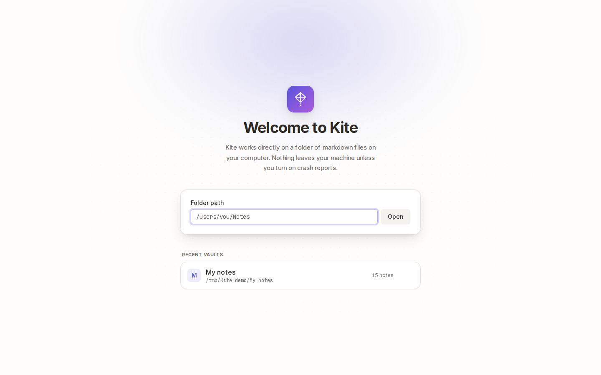
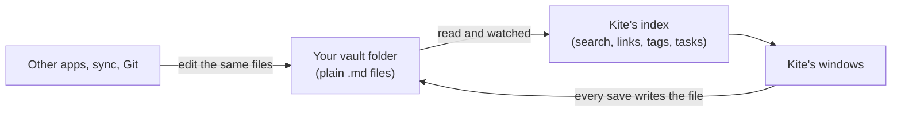
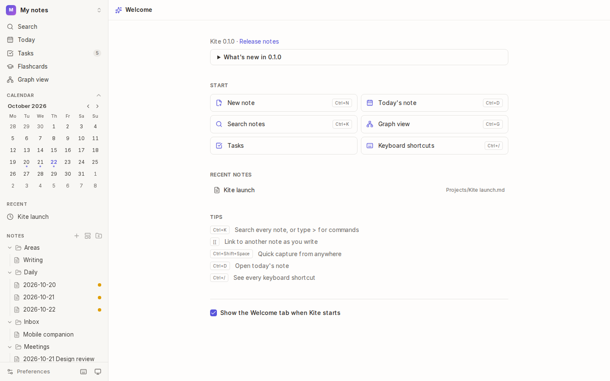

# Getting started

Kite works on a **vault**: an ordinary folder of Markdown (`.md`) files on your computer. You can open any folder as a vault, including one you already use with another app. Kite reads the files where they are and never moves them into a database of its own.



## How it works

Your notes stay plain files. Kite builds a search index and a map of the links between notes in its own database, and watches the folder so changes from other apps appear straight away.



- **Your files are the source of truth.** The index can always be rebuilt from them, so you can delete it, move the vault or open it on another computer.
- **Kite's own data** (comments, locked-note settings, flashcard schedules) lives in a hidden `.kite/` folder inside the vault, so it travels with your notes.

## Open a vault

1. Start Kite. The first time, it shows **Welcome to Kite**.
2. Choose **Choose a folder…** and pick the folder in your system's file dialog. Or type its path, such as `/Users/you/Notes` or `C:\Users\you\Notes`, and choose **Open**. For a new vault, make an empty folder first.
3. Kite reads every note in it. A large vault shows its progress while it's indexed for the first time, and you can start working meanwhile.

The screenshot above is from a browser, where there's no system file dialog, so only the path box shows.

Vaults you've opened before are listed under **Recent vaults**. To switch vaults later, choose the vault's name at the top of the sidebar, or press <kbd>Mod</kbd>+<kbd>O</kbd>.

> `Mod` is <kbd>⌘</kbd> on macOS and <kbd>Ctrl</kbd> on Windows and Linux, throughout this manual.

## Find your way around


The window has three parts:

1. **The sidebar** (left): search, today's note, tasks, flashcards and the graph at the top, then the calendar, your favourite and recent notes, and the file tree with your notes and folders. Views, saved searches and canvases are listed below the tree.
2. **The note** (middle): the editor, the rendered preview, or both side by side. The bar above it shows where the note is, whether it's saved, and buttons for the view mode, favourites, comments, the details panel and more actions (<kbd>⋯</kbd>).
3. **The details panel** (right): the note's local graph, its outline, backlinks, unlinked mentions, links, tags and properties. Toggle it with the panel button in the note's bar.

Kite saves as you type: the bar says **Saved** a moment after you stop.

## The Welcome tab



The Welcome tab has quick actions, your recent notes and a few tips. After an update it also shows what's new. Open it any time from the command palette (**Open the Welcome tab**) or from Kite's tray icon, and turn it off in [Preferences → Welcome](16-preferences-and-shortcuts.md).

## Your vault on disk

```text
My notes/
├── Projects/
│   └── Kite launch.md      ← your notes: plain Markdown
├── attachments/            ← pasted and dropped files
├── Launch plan.canvas      ← canvases (JSON Canvas)
└── .kite/
    ├── comments/           ← comments on notes
    ├── lock.json           ← locked-note settings (no secrets in plain text)
    └── flashcards.json     ← flashcard review schedules
```

Folders starting with a dot (such as `.git` or `.obsidian`) are ignored, and you can ignore others too, such as `node_modules`, in [Preferences → Vault files](16-preferences-and-shortcuts.md).

## Tips

- **Already use Obsidian?** Open the same folder in Kite. Wiki links, tags, frontmatter, callouts, embeds, block links and canvases all work the same way.
- **Syncing?** Kite works with any sync tool (iCloud, Dropbox, Syncthing, Git). It notices changes made elsewhere, and [never overwrites them silently](12-history-and-recovery.md).

## See also

- [Writing](02-writing.md): the editor and what you can put in a note.
- [Search and commands](06-search.md): <kbd>Mod</kbd>+<kbd>K</kbd> gets you almost anywhere.
