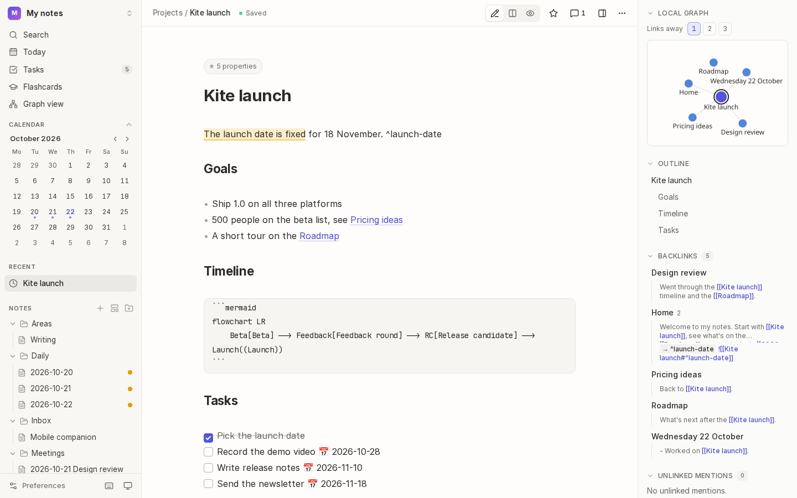
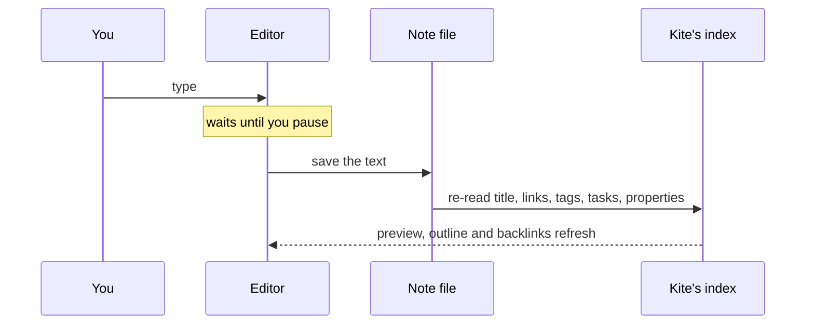
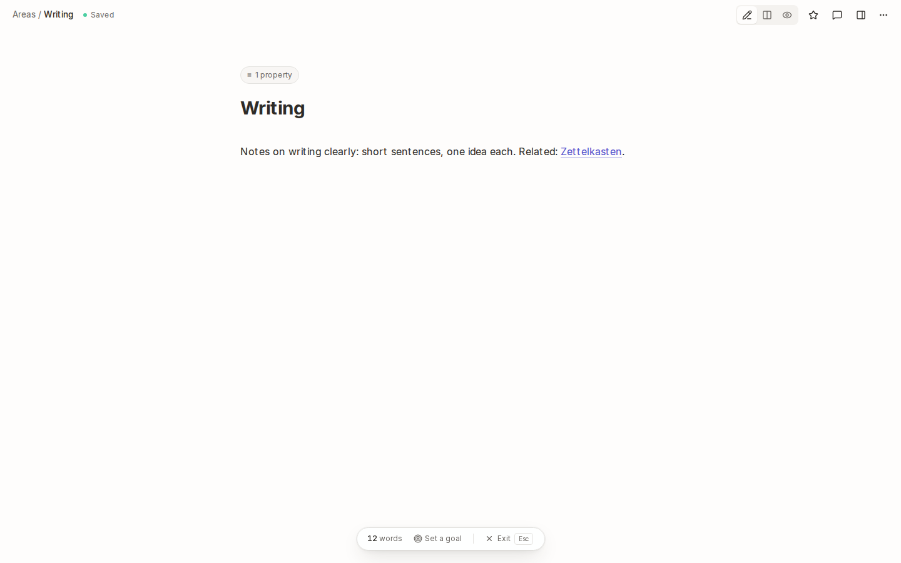
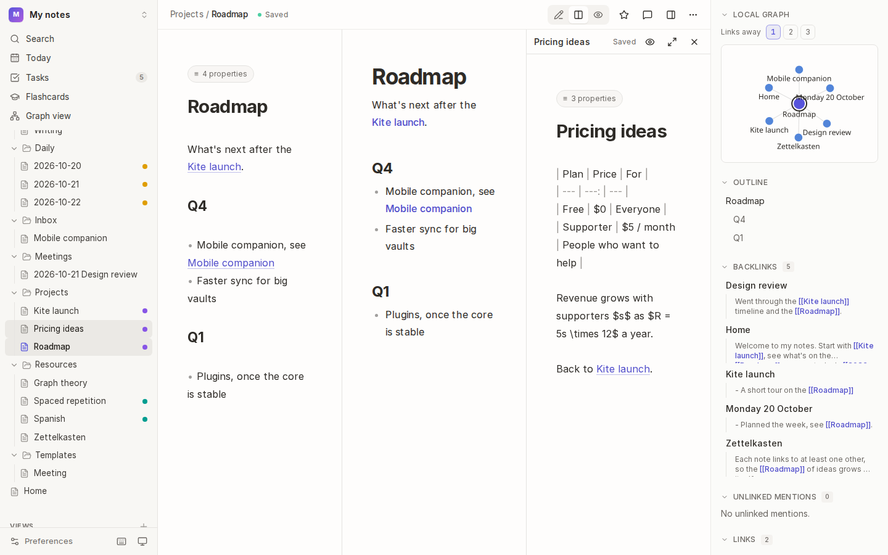
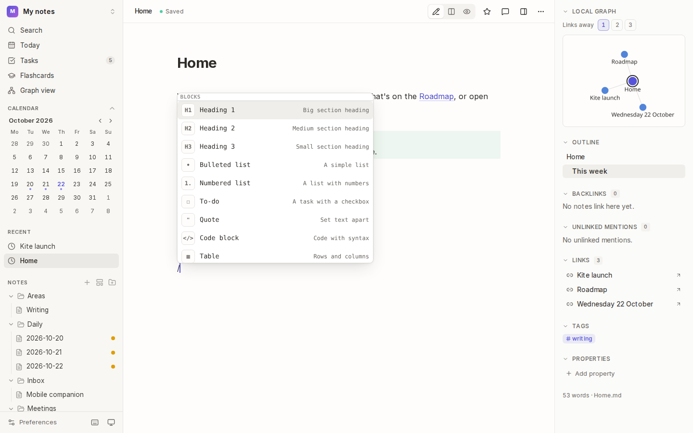
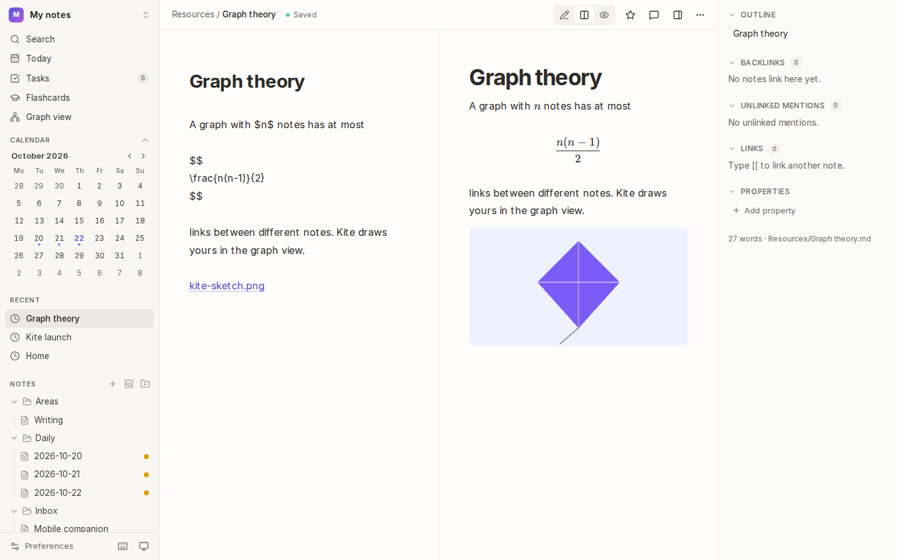
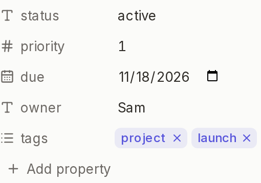

# Writing

Notes are Markdown. Kite's editor shows formatting as you type (headings look like headings, links like links), and a preview renders the note just as it will read.



## How it works

What you type is saved to the note's file a moment after you stop (400 ms by default), then re-indexed: its title, links, tags, tasks and properties update everywhere straight away.



- **The title** is the note's first top-level heading (`# Title`), or its file name when it has none. A `title` property wins over both.
- **Live preview** hides Markdown symbols on the lines you aren't editing. Turn it off in [Preferences → Editor](16-preferences-and-shortcuts.md) to see the plain text everywhere.

## Create a note

- Press <kbd>Mod</kbd>+<kbd>N</kbd>, or choose **+** next to **Notes** in the sidebar, or the **+** on a folder in the file tree to create it there.
- In the command palette (<kbd>Mod</kbd>+<kbd>K</kbd>), type a title that doesn't exist yet and choose **Create note**.
- Click a link to a note that doesn't exist yet: Kite creates it.
- To start from a template, press <kbd>Mod</kbd>+<kbd>Shift</kbd>+<kbd>N</kbd> (see [Daily notes and templates](03-daily-notes-and-templates.md)).

## Choose how to see a note

The three buttons in the note's bar switch between:

| Mode | Shows | Good for |
| --- | --- | --- |
| **Edit** | the editor, full width | writing |
| **Split** | the editor and preview side by side | checking tables, math and diagrams as you write |
| **Preview** | the rendered note | reading |

<kbd>Mod</kbd>+<kbd>E</kbd> toggles the preview. Kite remembers your choice.

### Focus mode



Press <kbd>Mod</kbd>+<kbd>Shift</kbd>+<kbd>F</kbd> (or choose **Focus mode** under <kbd>⋯</kbd>) to hide everything but the note. The bar at the bottom counts your words and lets you **Set a goal** (kept in the note's `word_goal` property). Press <kbd>Esc</kbd> to leave. The cursor's line stays in the middle of the screen as you write.

### Tabs and a second pane



- <kbd>Mod</kbd>+click a note (in the file tree, a link or search) to open it in a **new tab**. <kbd>Mod</kbd>+<kbd>W</kbd> closes a tab. Pin a tab to keep it open.
- <kbd>Mod</kbd>+<kbd>Shift</kbd>+click a note to open it in a **second pane** beside the current one. In the command palette, <kbd>Shift</kbd>+<kbd>Enter</kbd> does the same. Each pane edits and saves on its own.

## Format quickly with `/`



Type `/` at the start of a line (or after a space) for a menu of blocks. Keep typing to filter it, then press <kbd>Enter</kbd>:

| Command | Inserts |
| --- | --- |
| Heading 1, 2, 3 | `#`, `##`, `###` |
| Bulleted list, Numbered list, To-do | `- `, `1. `, `- [ ] ` |
| Quote, Code block, Divider | `> `, a fenced block, `---` |
| Table | a 2-column table to fill in |
| Math block, Diagram | `$$ … $$`, a Mermaid block |
| Link to note | `[[` and the note picker |
| Today's date, Current time, Tag | `2026-10-22`, `14:05`, `#` |

## What you can write



Everything in standard Markdown and GitHub Flavored Markdown (bold, italics, lists, tables, task lists, code blocks, links and images), plus:

| You write | You get |
| --- | --- |
| `> [!tip] Title` and lines starting `>` | a **callout**: `note`, `tip`, `warning`, `danger`, `example`, `question`, `quote` and more. Add `-` after the type (`[!tip]-`) to start it folded; click its title to open it. |
| `$x^2$` and `$$ … $$` | inline and block **math**, rendered by KaTeX |
| a ` ```mermaid ` code block | a **diagram**: flowcharts, sequences, timelines, pie charts… |
| `- [ ] Task 📅 2026-10-30` | a **task** with a due date (see [Tasks](07-views-and-tasks.md#tasks)) |
| `[[Note]]`, `![[Note]]` | a link to a note, or the note embedded (see [Links](04-links.md)) |
| `#tag` | a tag (see [Tags](05-tags-and-colour-groups.md)) |

### Images and other files

**Paste** an image or **drop** files onto the editor. Kite copies them into the vault's `attachments/` folder (you can change it in [Preferences → Vault files](16-preferences-and-shortcuts.md)) and inserts a link:

```markdown
![[kite-sketch.png]]          an image, shown in the note
![[kite-sketch.png|300]]      300 pixels wide (or 300x200)
[[Quarterly report.pdf]]      a link that opens the file
```

Images, PDFs, audio, video, and CSV, JSON or text files are supported, up to 50 MB each. Files already in the vault are found by name, wherever they are.

## Properties



Properties are the YAML **frontmatter** at the top of a note, between `---` lines. Kite edits them as typed fields in the details panel, so you don't have to write YAML:

1. Open the details panel and scroll to **Properties**.
2. Choose **Add property**, give it a name and pick a type: **text**, **number**, **date**, **checkbox** or **list**.
3. Edit values in place. Kite writes them back to the frontmatter.

In the editor, the frontmatter folds into a chip above the title (**5 properties**): choose it to see and edit the YAML itself.

Properties power [search filters](06-search.md) (`status:active`), [table and board views](07-views-and-tasks.md), and [colour groups](05-tags-and-colour-groups.md).

## Tips

- **Find and replace** in a note: <kbd>Mod</kbd>+<kbd>F</kbd>.
- **Tasks** can be ticked in the preview, the editor (with live preview on) or the [Tasks](07-views-and-tasks.md#tasks) page.
- **Wide tables or long lines?** Change the line width or font in [Preferences → Editor](16-preferences-and-shortcuts.md).

## See also

- [Links](04-links.md): connecting notes, embeds and block links.
- [Daily notes and templates](03-daily-notes-and-templates.md).
- [History and recovery](12-history-and-recovery.md): every save is kept.
