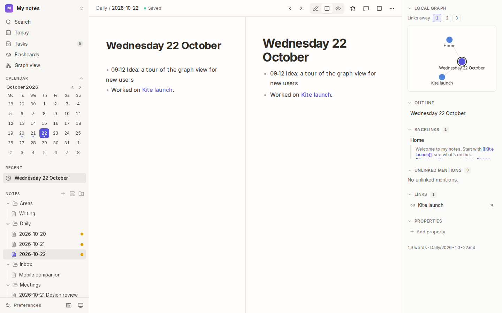
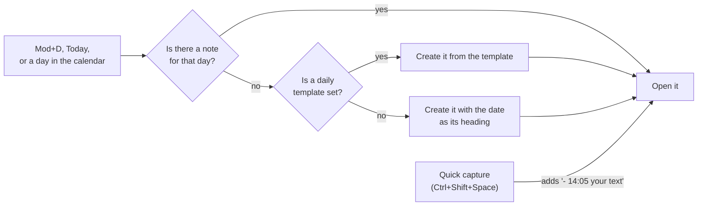
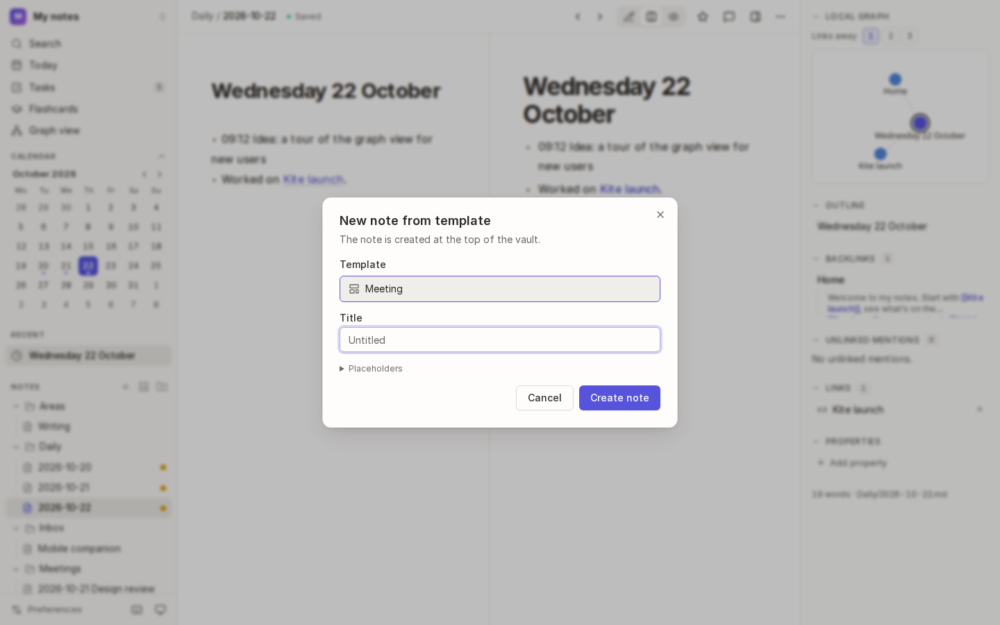
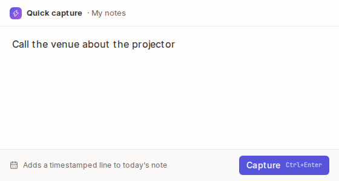

# Daily notes, templates and quick capture

A **daily note** is one note per day: somewhere to jot what happened, plan the day and link to what you worked on. **Templates** start new notes with the same structure every time. **Quick capture** adds a thought to today's note without switching to Kite.



## How it works



Daily notes are ordinary notes named after their date (`Daily/2026-10-22.md` by default), so you can link to them like any other: `[[2026-10-22]]`.

## Daily notes

### Open today's note

- Press <kbd>Mod</kbd>+<kbd>D</kbd>, or choose **Today** in the sidebar.
- The first time each day, Kite creates the note, headed with the date ("Wednesday, 22 October 2026").

### Go to another day

- **The calendar** in the sidebar marks days that have a note with a dot. Choose a day to open its note, or to create it.
- **The arrows** in a daily note's bar go to the previous and next day.
- Hide the calendar with the arrow next to **Calendar**.

### Set them up

In [Preferences → Daily notes](16-preferences-and-shortcuts.md) you can change:

| Setting | Default | Example |
| --- | --- | --- |
| Folder | `Daily` | `Journal/Days` |
| File name format (a PHP date format) | `Y-m-d` → `2026-10-22` | `d-m-Y` → `22-10-2026` |
| Template note | none | `Templates/Daily.md` |

## Templates

### Make a template

1. Create a folder called `Templates` (or choose another in [Preferences → Templates](16-preferences-and-shortcuts.md)).
2. Write a note in it with the structure you want. Use placeholders for what changes:

```markdown
---
tags: [meeting]
date: {{date}}
---
# {{title}}

## Attendees

## Notes

## Actions
- [ ]
```

| Placeholder | Becomes |
| --- | --- |
| `{{title}}` | the new note's title |
| `{{date}}`, `{{time}}`, `{{datetime}}` | today's date `2026-10-22`, the time `14:05`, or both |
| `{{date:D j M}}` | the date in any [PHP date format](https://www.php.net/manual/en/datetime.format.php): `Wed 22 Oct` |
| `{{yesterday}}`, `{{tomorrow}}` | the dates either side of today (handy in a daily template) |
| `{{folder}}`, `{{vault}}` | the folder the note goes in, and the vault's name |

Notes in the templates folder are left out of filtered searches, tasks, flashcards, unlinked mentions and the graph, so `{{placeholders}}` don't clutter them.

### Use a template



1. Press <kbd>Mod</kbd>+<kbd>Shift</kbd>+<kbd>N</kbd> (or choose **New note from template** in the command palette). To create the note inside a folder, use the template button on that folder in the file tree.
2. Pick the **Template**, type a **Title**, and choose **Create note**.

**Placeholders** in the dialog lists them all, in case you forget.

## Quick capture



Quick capture is a small window that pops up over whatever you're doing. What you type is added to the end of today's note as a timestamped line (`- 14:05 Call the venue about the projector`), in the vault you opened most recently.

1. Press <kbd>Ctrl</kbd>+<kbd>Shift</kbd>+<kbd>Space</kbd> (<kbd>⌘</kbd>+<kbd>Shift</kbd>+<kbd>Space</kbd> on macOS), even when Kite is in the background. Or choose **Quick capture…** from Kite's icon in the system tray (the menu bar on macOS).
2. Type. Several lines become one entry, indented under its time.
3. Press <kbd>Mod</kbd>+<kbd>Enter</kbd> (or **Capture**) to add it, or <kbd>Esc</kbd> to close the window without adding anything.

Change the shortcut, or turn it off, in [Preferences → Quick capture](16-preferences-and-shortcuts.md). Quick capture is only in the desktop app.

## Tips

- **Link your days:** a daily template with `[[{{yesterday}}]] · [[{{tomorrow}}]]` gives each day links either side.
- **Tasks in daily notes** show up on the [Tasks](07-views-and-tasks.md#tasks) page with everything else, so nothing jotted in a hurry gets lost.

## See also

- [Writing](02-writing.md) · [Links](04-links.md) · [Views and tasks](07-views-and-tasks.md)
