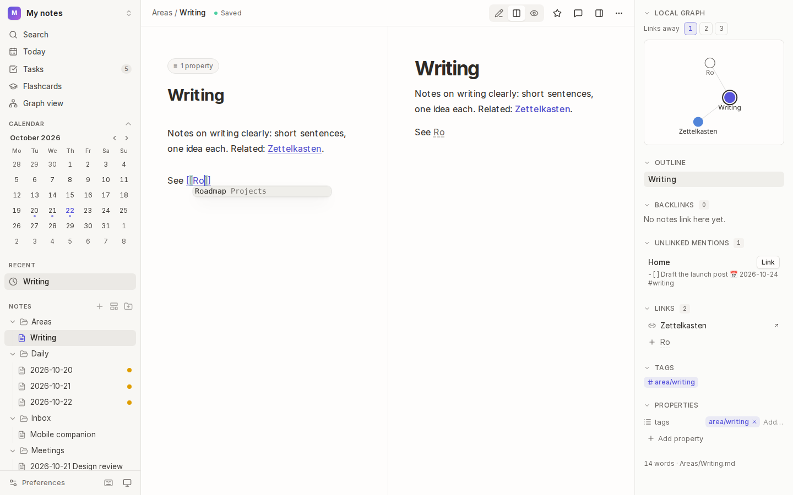
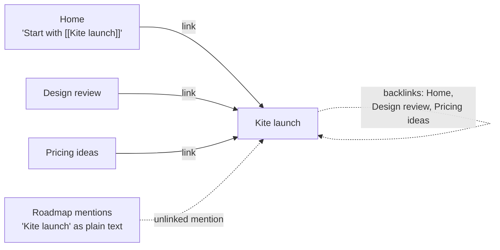
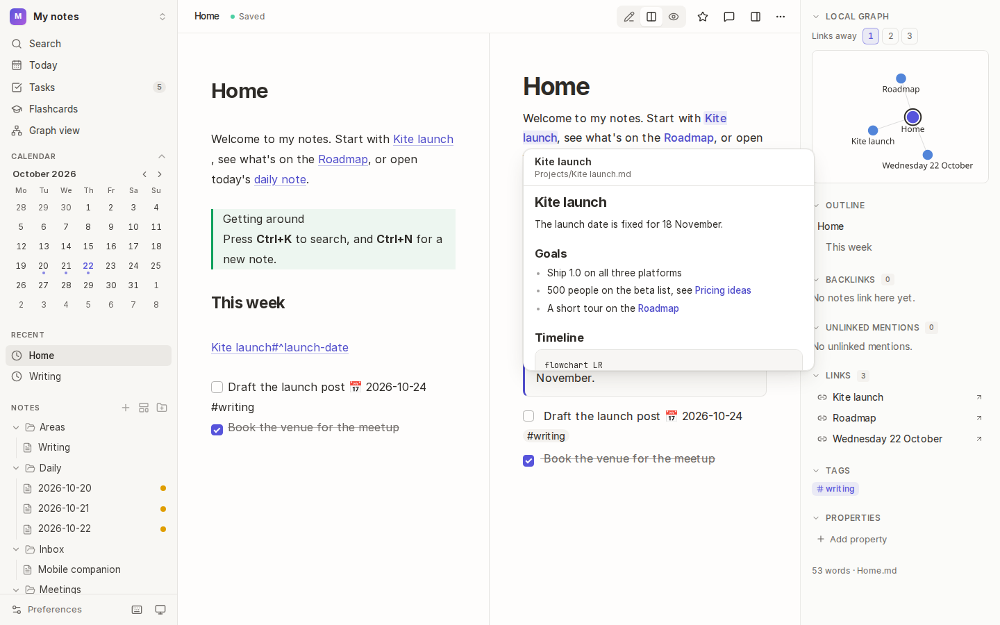
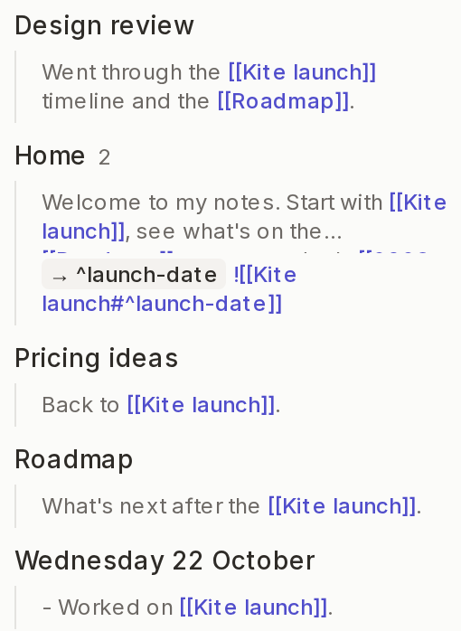

# Links

Links are what make a vault more than a pile of notes. Type `[[` to link to another note, and Kite keeps track of every link in both directions: what a note links to, and what links to it.



## How it works



- Every note's links are indexed when it's saved, so **backlinks** (the notes linking to this one) are always current.
- A link names a note, not a path: `[[Kite launch]]` finds `Projects/Kite launch.md` wherever it is. If two notes have the same name, the one nearest the top of the vault wins, and you can be specific with a path: `[[Projects/Kite launch]]`.
- **Rename or move a note in Kite**, and every link to it is rewritten. Moving it in another app keeps its history, and links find it by its new name.

## Make a link

1. Type `[[` and start typing a note's name. Kite suggests matching notes.
2. Press <kbd>Enter</kbd> to pick one. Kite closes the link with `]]`.

| You write | It links to | It shows |
| --- | --- | --- |
| `[[Kite launch]]` | the note | Kite launch |
| `[[Kite launch\|the launch]]` | the note | the launch |
| `[[Kite launch#Goals]]` | the **Goals** heading | Kite launch › Goals |
| `[[#Goals]]` | a heading in this note | Goals |
| `[[Kite launch#^launch-date]]` | a block (see below) | Kite launch › ^launch-date |
| `[Read this](Projects/Kite%20launch.md)` | the note, as a Markdown link | Read this |

A link to a note that doesn't exist yet is shown faded. Click it to create the note.

### Follow a link

- In the preview, click it.
- In the editor, <kbd>Mod</kbd>+click it.
- Add <kbd>Mod</kbd> in the preview to open it in a new tab, or <kbd>Mod</kbd>+<kbd>Shift</kbd> to open it beside the note.

## Preview a link



Rest the pointer on a link in the preview for a moment, and a card shows the note it goes to: just the heading or block, if the link points at one. In the editor, hold <kbd>Mod</kbd> while you rest on a link, so cards don't pop up while you write. Move into the card to scroll it, and press <kbd>Esc</kbd> or move away to close it.

## Embed a note

Put `!` in front of a link, on a line of its own, to show the note (or part of it) inside this one:

```markdown
![[Kite launch]]                 the whole note
![[Kite launch#Timeline]]        just the Timeline section
![[Kite launch#^launch-date]]    just one block
![[kite-sketch.png|300]]         an image, 300 pixels wide
```

The embed's title links to the original, and it updates when the original changes. Embeds can contain embeds, up to three deep. A locked note isn't shown in an embed.

## Link to a block

A **block** is a paragraph, list item, table or quote. Give it an id, and you can link to exactly that block:

1. Put the cursor in the paragraph or list item.
2. Open the command palette (<kbd>Mod</kbd>+<kbd>K</kbd>) and choose **Copy link to this block**.
3. Kite adds an id such as ` ^k3x9qa` at the end of the line (if it has none) and copies `[[Kite launch#^k3x9qa]]`. Paste it anywhere.

Or write the id yourself: end the line with a space and `^my-id`. For a table or quote, put `^my-id` on its own line just after it. The id is hidden in the preview, and following the link lands on the block.

## See what links here



The details panel lists everything connected to the note:

- **Backlinks:** each note that links here, with the line the link is on. When a link points at a heading or block, it's labelled (`→ ^launch-date`). Choose a line to open the note at it.
- **Outline:** the note's headings. A number beside a heading counts the links from other notes that point at it.
- **Unlinked mentions:** notes that mention this note's title without linking to it. Choose **Link** to turn the mention into a link.
- **Links:** the notes this one links to. Links to notes that don't exist yet have a **+** to create them.
- **Local graph:** the note and its neighbours, 1 to 3 links away (see [Graph](08-graph.md)).

## Tips

- **Rename or move** a note with **Rename or move** under <kbd>⋯</kbd>, or drag it to another folder in the file tree. Links follow.
- **Aliases for display, not lookup:** `[[Kite launch|the launch]]` changes what's shown, not which note is found.
- **Link to today:** `[[2026-10-22]]` links to that day's [daily note](03-daily-notes-and-templates.md).

## See also

- [Tags and colour groups](05-tags-and-colour-groups.md) · [Graph](08-graph.md) · [Reorganising notes](11-reorganising-notes.md)
