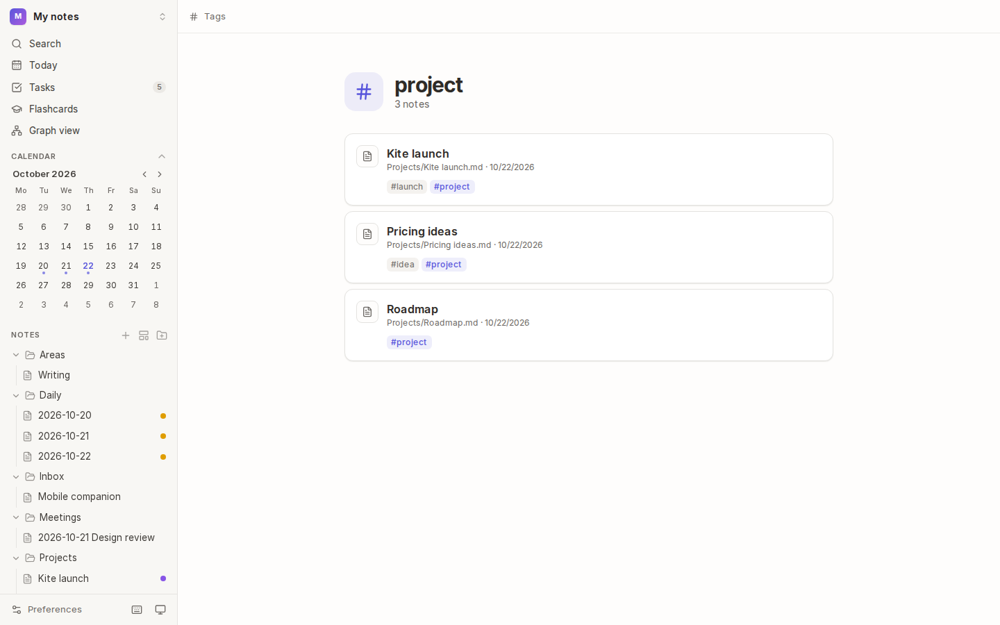
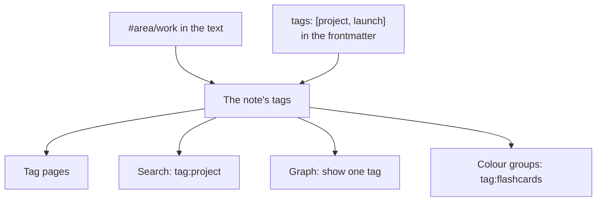
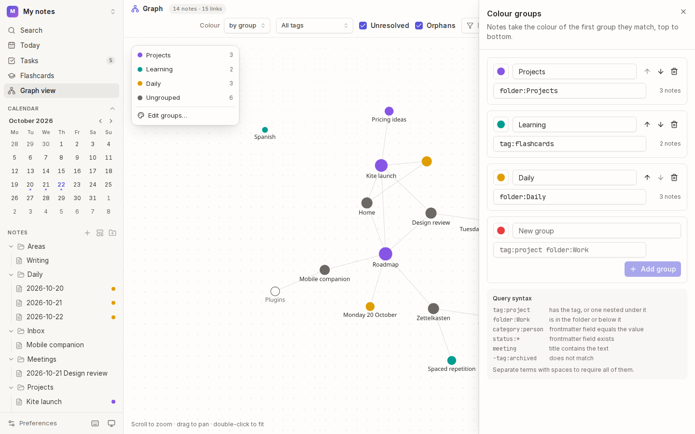
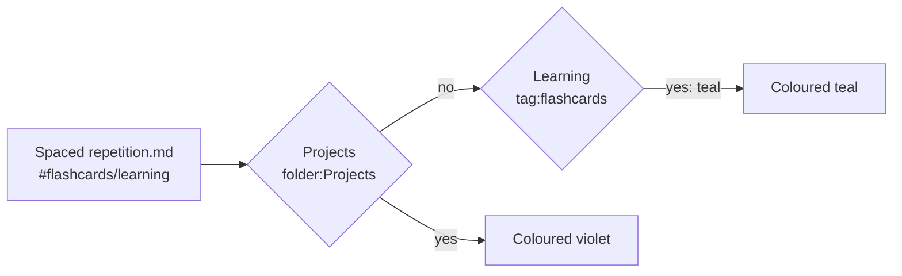

# Tags and colour groups

**Tags** label notes across folders: `#idea`, `#meeting`, `#area/work`. **Colour groups** give notes a colour by a rule (every note in `Projects`, every note tagged `#flashcards`), so you can tell them apart at a glance in the file tree and the graph.



## How tags work



A note's tags are the `#tags` in its text plus the `tags` in its frontmatter. Tags in code blocks and inline code don't count.

## Add tags

- **In the text:** type `#` and a name: `#idea`. Names can use letters (in any language), digits, `_`, `-` and `/`, and need at least one letter, so `#2026` isn't a tag.
- **In the frontmatter:** a list, or words separated by commas or spaces:

  ```yaml
  ---
  tags: [project, launch]
  ---
  ```

- **Nested tags** use `/`: `#area/work`, `#area/home`. Searching for or opening `area` includes both.

## Use tags

- **Click a tag** in a note (or in the details panel's **Tags**) to see every note with it, most recently changed first. Nested tags are included.
- **Search** with `tag:project`, or `-tag:archived` to leave notes out (see [Search](06-search.md)).
- **Tasks** can be filtered by tag on the [Tasks](07-views-and-tasks.md#tasks) page.
- **The graph** can show the notes with one tag (see [Graph](08-graph.md)).

## Colour groups



A colour group is a **name**, a **colour** and a **rule**. Each note takes the colour of the first group it matches, top to bottom. Notes no group matches stay grey.



### Make a group

1. Open the graph (<kbd>Mod</kbd>+<kbd>G</kbd>), choose the colour legend in its top-left corner, then **Edit groups…**.
2. Under **New group**, pick a colour, type a name and a rule, and choose **Add group**. The number beside each rule shows how many notes it matches, as you type.
3. Use the arrows to change the order (the first match wins), or the bin to remove a group.

### Write a rule

| Rule | Matches notes that… |
| --- | --- |
| `tag:project` | have the tag, or a tag nested under it |
| `folder:Work` | are in the folder or below it |
| `status:active` | have that frontmatter property with that value |
| `status:*` | have the property at all |
| `meeting` | have the word in their title |
| `-tag:archived` | don't match (put `-` in front of any rule) |

Separate rules with spaces to require all of them: `folder:Projects -status:done`. The same language works in [search](06-search.md), [views](07-views-and-tasks.md) and the [graph's filter](08-graph.md).

### Where colours show

- **The graph**, when **Colour** is set to **by group**.
- **The file tree**, as a dot beside each note. Turn this off in [Preferences → File tree](16-preferences-and-shortcuts.md).

## Tips

- **Organise by meaning, not place:** folders hold a note in one place, but a note can have many tags and match many rules.
- **Colour by tag or folder instead:** the graph's **Colour** menu can colour notes by their first tag or their folder, with no setup.

## See also

- [Search and commands](06-search.md) · [Graph](08-graph.md) · [Views and tasks](07-views-and-tasks.md)
