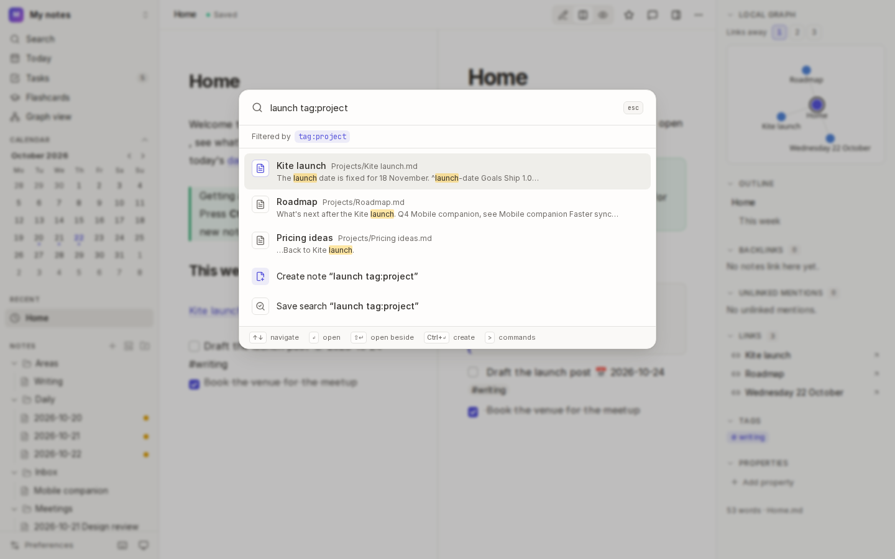
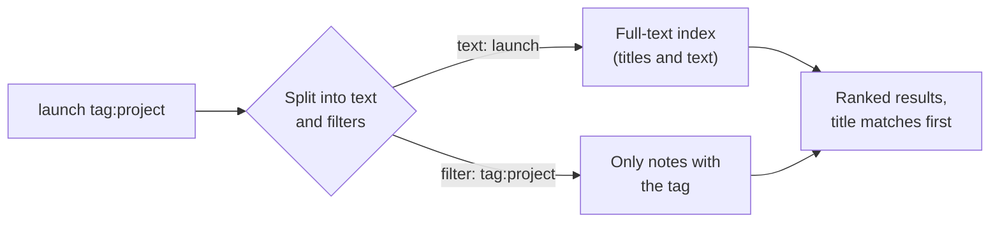
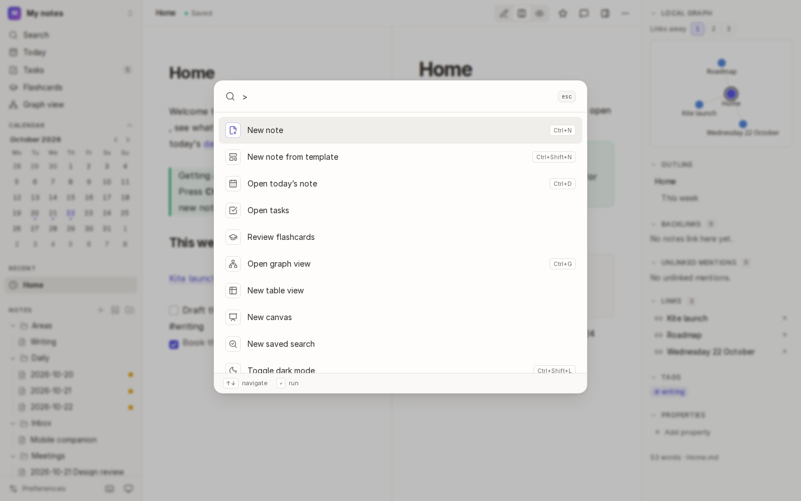
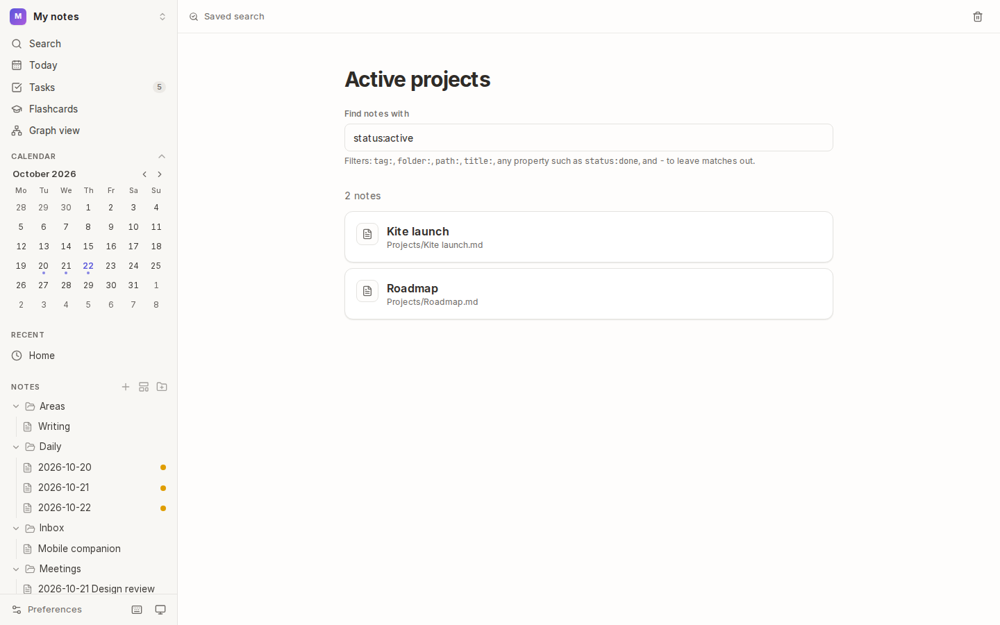

# Search and commands

The **command palette** is the quickest way around Kite. Press <kbd>Mod</kbd>+<kbd>K</kbd> and type: it searches every note, runs any command, and creates a note if nothing matches. Searches you use often can be **saved** in the sidebar.

## How it works

- Kite searches note **titles and text**, ignoring case and accents. Words match their beginnings (`interv` finds "interview"), and related forms ("plan" finds "planning").
- Matches in a title rank above matches in the text. Each result shows a snippet with the words highlighted.
- Search stays fast in big vaults: a few tens of milliseconds with 10,000 notes.

## Search

1. Press <kbd>Mod</kbd>+<kbd>K</kbd> (or choose **Search** in the sidebar).
2. Type words, filters or both. With nothing typed, your recently changed notes are listed.
3. Use the arrow keys to choose a result, then:

| Press | To |
| --- | --- |
| <kbd>Enter</kbd> | open the note |
| <kbd>Shift</kbd>+<kbd>Enter</kbd> | open it beside the current note |
| <kbd>Mod</kbd>+<kbd>Enter</kbd> | create a note titled with what you typed |
| <kbd>Esc</kbd> | close the palette |

### Filters

Filters narrow a search, and combine with words and with each other:

| Filter | Finds notes… |
| --- | --- |
| `tag:project` | tagged `#project`, or a tag nested under it (`#project/kite`) |
| `folder:Work` | in the `Work` folder or below it |
| `path:2026` | whose path contains the text |
| `title:launch` | whose title contains the text |
| `status:done` | with a property `status` set to `done` (any property works) |
| `status:*` | with a `status` property at all |
| `-tag:archived` | **without** a match (`-` in front of any filter) |
| `status:"in progress"` | with a value that has spaces |

For example, `budget folder:Projects -status:done` finds notes about budgets in Projects that aren't done. The filters in use are shown under the search box.

## Run a command

Type `>` in the palette to run a command by name: `>graph`, `>dark`, `>history`, `>lock`. Commands that act on a note, such as **Show version history** or **Copy link to this block**, are offered while a note is open. Each command shows its keyboard shortcut, if it has one.

## Save a search

1. Type a search in the palette and choose **Save search**. Or choose **+** next to **Searches** in the sidebar.
2. It's listed under **Searches** in the sidebar. Open it to see its results, always up to date.
3. Change its name or its search on its page, or delete it with the bin in its bar.

## Search inside a note

Press <kbd>Mod</kbd>+<kbd>F</kbd> in the editor to find (and replace) text in the open note.

## Tips

- **Start with a filter:** `tag:meeting` on its own lists every meeting note, most recently changed first.
- **Make it a view:** if you want a search's notes as a table of their properties, make a [table view](07-views-and-tasks.md) with the same filters.

## See also

- [Tags and colour groups](05-tags-and-colour-groups.md) · [Views and tasks](07-views-and-tasks.md) · [Preferences and shortcuts](16-preferences-and-shortcuts.md)
