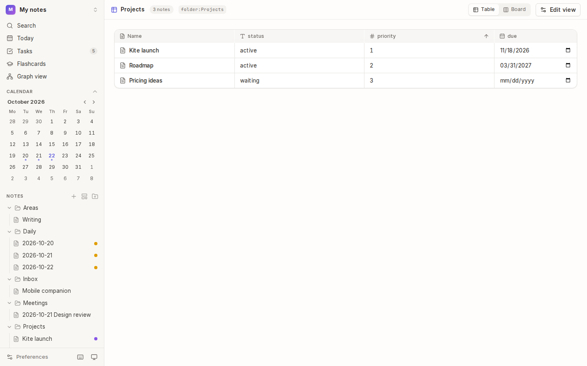
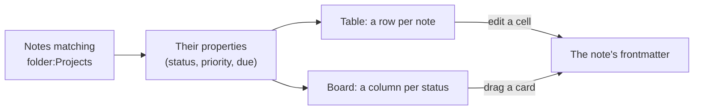
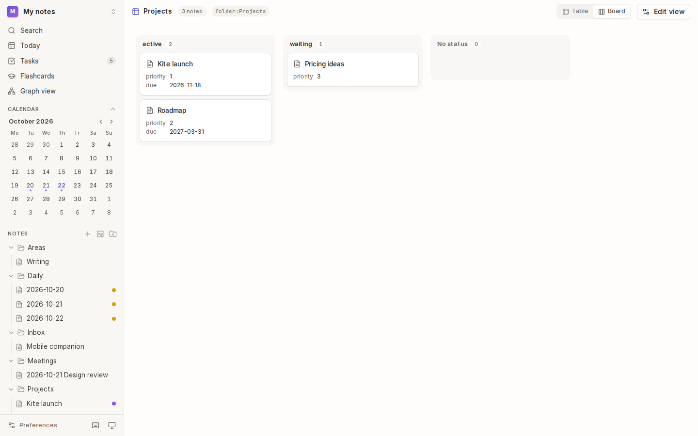
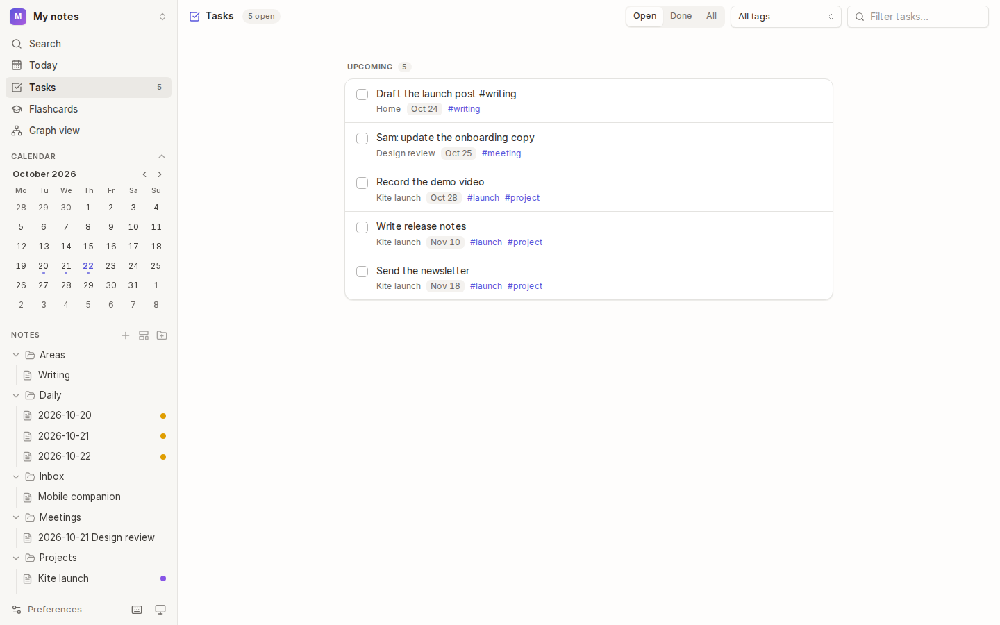

# Views and tasks

A **table view** lists notes as rows and their properties as columns, so a folder of project notes becomes a project tracker. The same view can be a **board**, with a column for each status. The **Tasks** page gathers every checkbox in the vault into one list.



## How views work



A view is a saved question ("which notes, which columns"), not a copy of anything. Its rows always reflect your notes, and editing a cell writes the value into that note's frontmatter, just as the [properties panel](02-writing.md#properties) does.

## Make a view

1. Choose **+** next to **Views** in the sidebar, or **New table view** in the command palette.
2. Choose **Edit view** and set:
   - **Name**, as it appears in the sidebar.
   - **Notes:** which notes to include, written like a [search filter](06-search.md#filters): `folder:Projects`, `tag:book -status:read`. Leave it empty for all notes.
   - **Columns:** properties to show. Kite suggests the properties those notes use most. Add others under **Another property**.
   - **Layout:** **Table** or **Board**, and for a board, the property to **Group board by**.
3. Save. The view is listed under **Views** in the sidebar.

## Use a table

- **Sort** by a column: choose its heading. Choose it again to reverse the order.
- **Edit** a value in place: text and numbers are typed, dates picked, checkboxes ticked. The note's file is updated straight away.
- **Open** a note: choose its name.

## Use a board



Switch between **Table** and **Board** at the top right. A board has a column for each value of its group property (here, `status`), and one for notes without it.

- **Drag a card** to another column to change its value: dragging **Pricing ideas** to **active** sets its `status` to `active`.
- Each card shows the view's other columns as details.

## Tasks



### Write a task

A task is a list item with a checkbox, anywhere in any note:

```markdown
- [ ] Record the demo video 📅 2026-10-28
- [ ] Write release notes due:2026-11-10
- [x] Pick the launch date
```

- `📅 2026-10-28` or `due:2026-10-28` gives it a **due date**.
- `#tags` in the task's line, or on its note, let you filter tasks by tag.
- Typing `/` and choosing **To-do** starts a task line.

### See all your tasks

Choose **Tasks** in the sidebar (its badge counts open tasks). Tasks are grouped by when they're due:

| Group | Holds |
| --- | --- |
| **Overdue** | open tasks due before today |
| **Today** | open tasks due today |
| **Upcoming** | open tasks due later |
| **No date** | open tasks without a due date |
| **Done** | completed tasks |

- **Tick** a task to complete it. Kite changes `[ ]` to `[x]` in its note.
- **Choose a task's text** to open its note at that line.
- **Filter** with **Open**, **Done** or **All**, by tag, or by text, at the top right.

## Tips

- **Reading list:** a view of `tag:book` with columns `author`, `rating` and `status`, as a board grouped by `status` (to read, reading, read).
- **Due dates on notes:** a `due` date property sorts and edits like any other column. Due dates on tasks are separate and show on the Tasks page.

## See also

- [Writing → Properties](02-writing.md#properties) · [Search filters](06-search.md#filters) · [Daily notes](03-daily-notes-and-templates.md)
