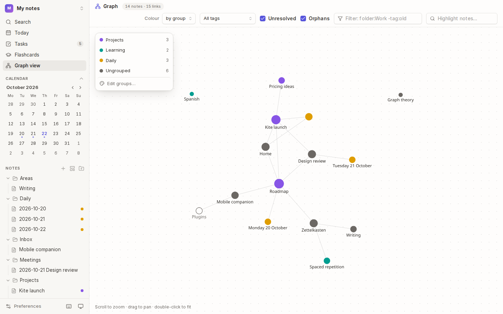
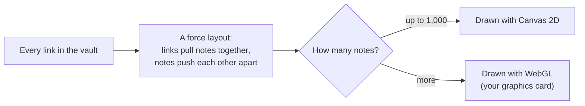
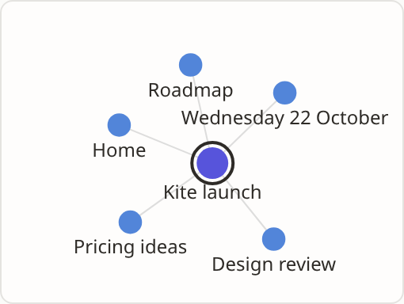

# Graph

The **graph view** draws every note as a dot and every link as a line, so you can see how your ideas connect: which notes are hubs, which stand alone, and which clusters have formed. Each note also has a **local graph** of just its neighbourhood.

## How it works

- **Dots** are notes, sized by how many links they have. **Hollow dots** are links to notes that don't exist yet.
- **Lines** are links, in either direction.
- The layout settles over a few seconds. Notes that link to each other end up close together, so related notes form clusters.
- It stays smooth with thousands of notes: above 1,000, Kite draws with your graphics card.

## Open the graph

Press <kbd>Mod</kbd>+<kbd>G</kbd>, or choose **Graph view** in the sidebar.

| To | Do this |
| --- | --- |
| Zoom | scroll, or pinch on a trackpad |
| Move around | drag empty space |
| Fit everything in view | double-click empty space |
| Move a note | drag its dot |
| See a note's links | rest the pointer on it: its neighbours stay bright |
| Open a note | click its dot |

## Choose what's shown

The bar at the top changes what the graph shows:

| Control | Does |
| --- | --- |
| **Colour** | colours notes **by group** (your [colour groups](05-tags-and-colour-groups.md#colour-groups)), **by folder** or **by tag** |
| **All tags** | shows only the notes with one tag |
| **Unresolved** | shows or hides links to notes that don't exist yet |
| **Orphans** | shows or hides notes with no links at all |
| **Filter** | shows only notes matching a rule, such as `folder:Work -tag:old` (the [search filter](06-search.md#filters) language) |
| **Highlight notes** | keeps the notes whose titles match bright and dims the rest |

The legend in the top-left corner lists the groups, with counts. Choose a group there to hide or show its notes, and **Edit groups…** to open the [colour groups editor](05-tags-and-colour-groups.md#make-a-group). When filters hide everything, choose **Reset filters**.

## The local graph

At the top of the details panel, the **local graph** shows the open note and the notes around it.

- **Links away** sets how far it reaches: **1** for direct links, up to **3** for links of links of links.
- Click a note in it to open that note.
- With very well-linked notes, it shows the closest ones and says how many it left out.

## Tips

- **Find orphans:** turn **Orphans** on and **Unresolved** off, then look for dots on their own: notes nothing links to yet.
- **Find gaps:** hollow dots are notes you've linked to but not written. Click one to write it.
- **Big vaults** look best coloured by group, with orphans hidden. See the README's graph of 10,000 notes.

## See also

- [Links](04-links.md) · [Tags and colour groups](05-tags-and-colour-groups.md) · [Canvases](09-canvases.md)
