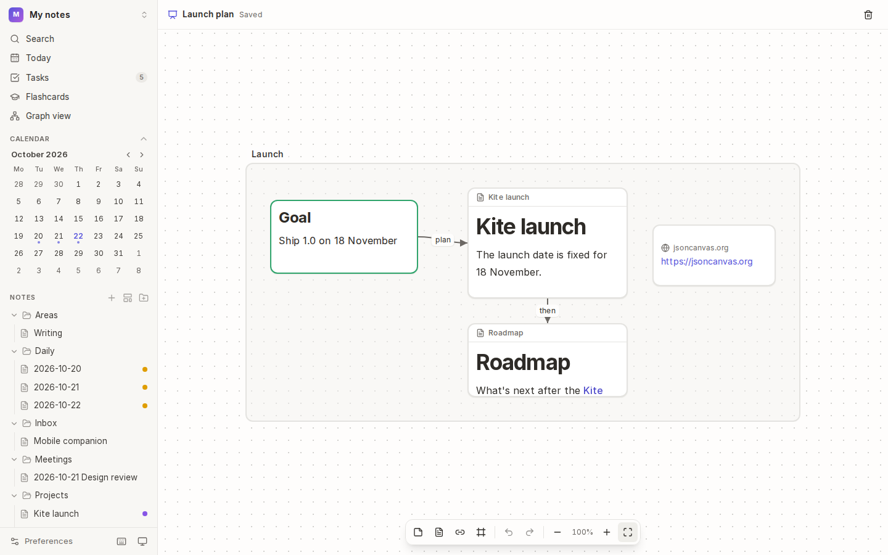
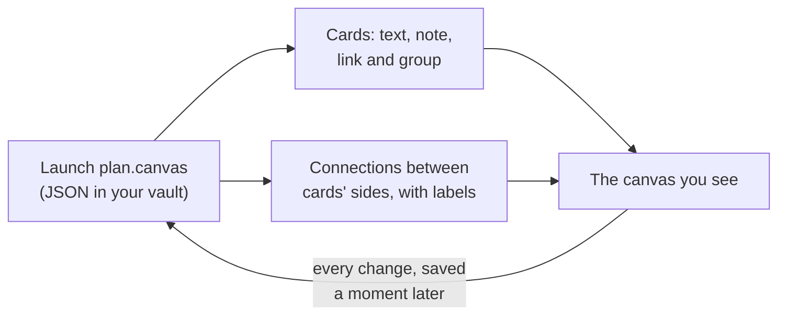

# Canvases

A **canvas** is an endless whiteboard. Put text cards, notes, links and groups on it, and connect them with arrows, to plan a project, map an argument or lay out a story. Canvases are saved as open [JSON Canvas](https://jsoncanvas.org) files, which Obsidian can open too.

## How it works

- **Text cards** hold Markdown of their own. **Note cards** show a note from your vault and stay in step with it. **Link cards** show a web address. **Groups** are labelled areas that hold other cards.
- Changes are saved a moment after you make them. If the file changes on disk while it's open (say, edited in Obsidian), Kite stops saving and offers to **Reload**, so neither copy is lost.

## Make a canvas

1. Choose **+** next to **Canvases** in the sidebar, or **New canvas** in the command palette.
2. The canvas opens, empty. It's listed under **Canvases** in the sidebar.

## Add cards

The toolbar at the bottom adds cards in the middle of the view:

| Button | Adds |
| --- | --- |
| **Add a card** | a text card: start typing |
| **Add a shape** | a flowchart shape (see below): start typing its text |
| **Add a note** | a note card: pick a note |
| **Add a link** | a link card: type a web address |
| **Add a group** | a group (or **Group the selection**, to put selected cards in one) |

You can also **double-click empty space** for a new text card, or **drag a note** from the file tree onto the canvas.

### Shapes for flowcharts

Choose **Add a shape** for the usual flowchart shapes. Their text sits in the middle, and they connect like any card.

| Shape | Usually means |
| --- | --- |
| Process (rectangle) | a step |
| Start or end (pill) | where the flow starts or stops |
| Decision (diamond) | a question with more than one way on, such as yes or no |
| Input or output (parallelogram) | data coming in or going out |
| Connector (circle) | a join, or a jump to another part of the chart |
| Predefined process | a step described somewhere else |
| Document | a document or report |
| Database (cylinder) | stored data |

To change a text card's shape, or turn a shape back into an ordinary card, select it and choose **Shape** in the toolbar. Shapes are saved the way Obsidian's Advanced Canvas plugin saves them, so they look the same there; plain Obsidian shows them as ordinary cards.

## Connect cards

1. Move the pointer over a card: a handle appears on each side.
2. Drag a handle to another card. Dropping it on empty space makes a new card there, already connected.
3. Double-click a connection to give it a label, such as "plan" or "then".

### Arrows and lines

A connection has an arrowhead where it ends. Select one or more connections, then choose in the toolbar:

| Button | Does |
| --- | --- |
| **Arrow at one end** | an arrowhead at one end only |
| **Arrows at both ends** | an arrowhead at each end, for a two-way connection |
| **No arrows** | a plain line |
| **Reverse direction** | swap the ends, so the arrow points the other way |
| **Line style** | a solid, dashed or dotted line |

## Arrange and edit

| To | Do this |
| --- | --- |
| Select | click a card, or drag across empty space to select several |
| Move | drag a card (a group moves with everything in it) |
| Resize | drag a card's bottom-right corner |
| Edit | double-click a text card (or a group, to rename it), or select it and press <kbd>Enter</kbd> |
| Colour | select cards and pick a colour in the toolbar |
| Delete | select and press <kbd>Delete</kbd> or <kbd>Backspace</kbd> |
| Undo, redo | <kbd>Mod</kbd>+<kbd>Z</kbd>, <kbd>Mod</kbd>+<kbd>Y</kbd> |
| Select all | <kbd>Mod</kbd>+<kbd>A</kbd> |

## Move around

| To | Do this |
| --- | --- |
| Pan | scroll, or hold <kbd>Space</kbd> (or the middle mouse button) and drag |
| Zoom | pinch, <kbd>Mod</kbd>+scroll, or **Zoom in** and **Zoom out** in the toolbar |
| See everything | **Show everything** in the toolbar |

## Tips

- **Notes, not copies:** a note card is the note itself. Edit the note and the card updates, and if you rename or move the note, the canvas follows.
- **Obsidian users:** your existing `.canvas` files open in Kite as they are, and Kite keeps anything it doesn't use, so they round-trip safely.
- **Delete a canvas** with the bin in its bar. In the desktop app it goes to your system's trash.

## See also

- [Graph](08-graph.md) · [Links](04-links.md)
