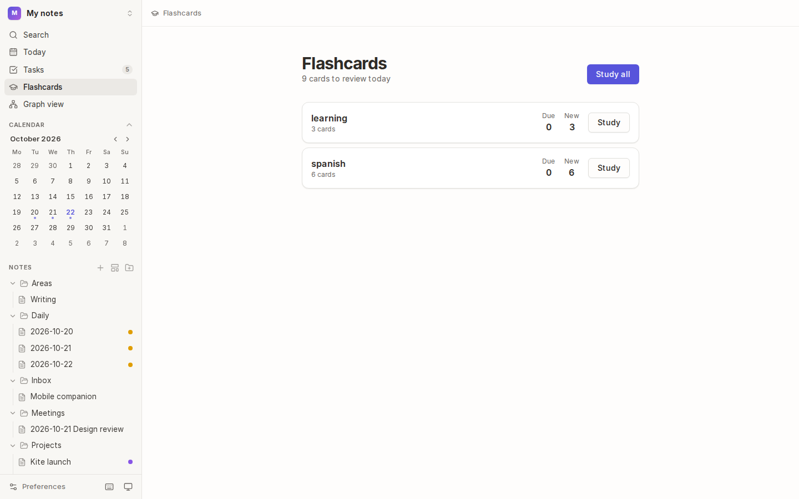
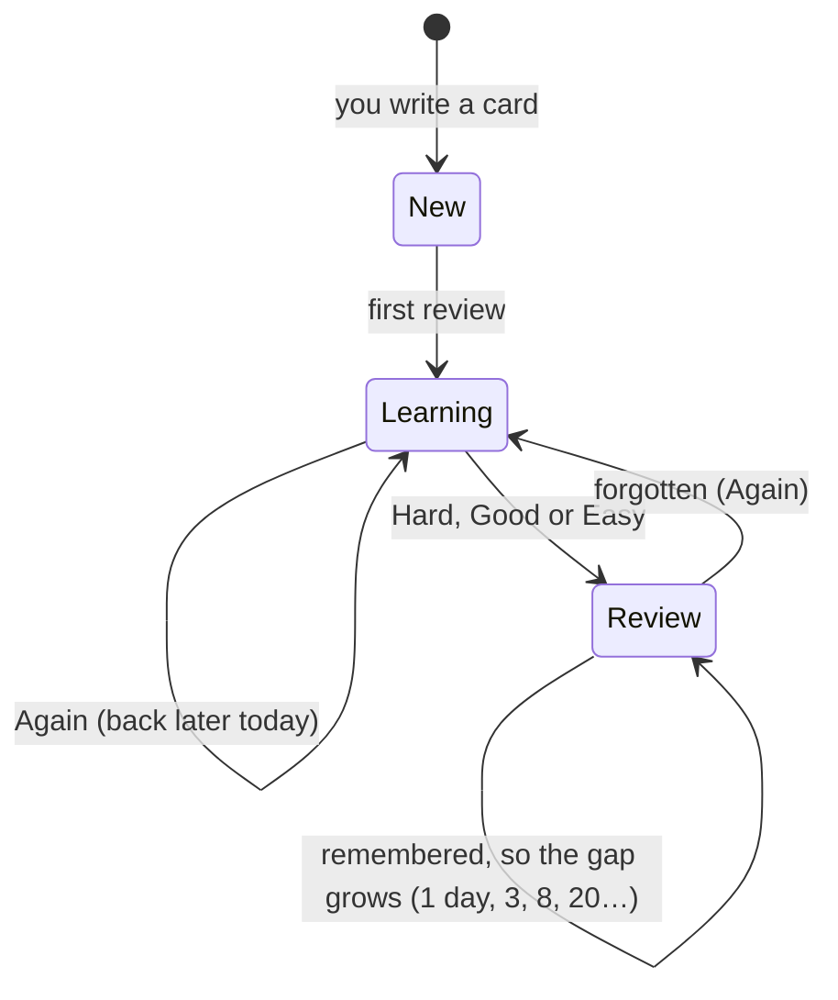
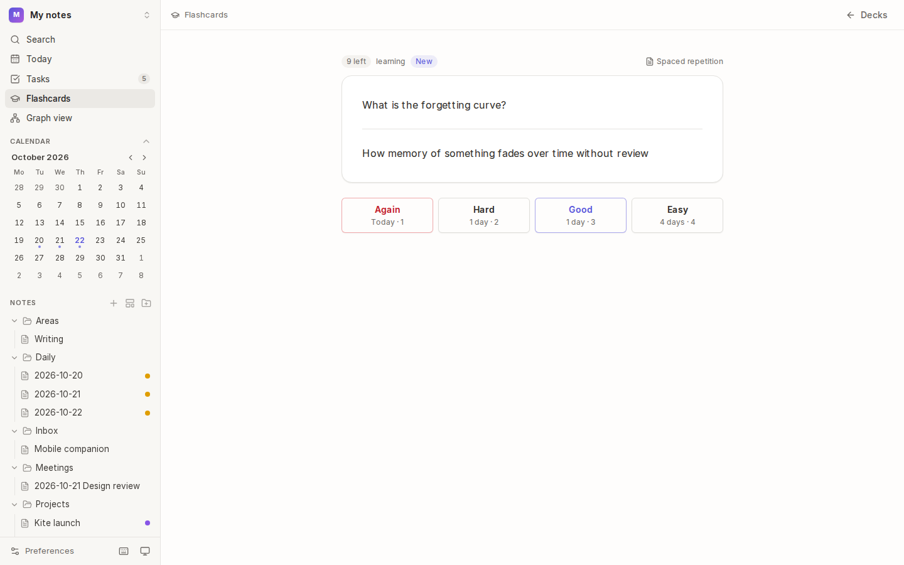

# Flashcards

Turn what you write into quiz cards. Kite shows each card again just before you'd forget it (**spaced repetition**, the method behind Anki), so a few minutes a day keeps what you've learned.



## How it works



- Each card has an **interval** (days until you see it again) that grows each time you remember it. Easy cards grow faster, hard ones slower.
- Forget a card and it comes back today, then grows more slowly from then on.
- Each deck brings in at most **20 new cards a day**, so a big new note doesn't flood a session.
- **Your notes are never edited.** Review progress is kept in `.kite/flashcards.json` in the vault, so it travels with your notes.

## Write cards

1. Tag a note `#flashcards`, or `#flashcards/deck-name` to put its cards in a deck (plain `#flashcards` goes in "General").
2. Write cards anywhere in the note:

```markdown
#flashcards/spanish

el perro ::: the dog
What is the capital of Spain? :: Madrid
The Prado is in ==Madrid==.

Name the three official languages of Spain
other than Spanish.
?
Catalan, Galician and Basque.
```

| You write | You get |
| --- | --- |
| `Question :: Answer` | one card |
| `word ::: translation` | two cards, one asked each way |
| `==highlighted==` text | a fill-in-the-blank card for each highlight |
| question lines, a `?` line, answer lines | a longer card, ending at a blank line |

Cards inside code blocks are ignored, so `Foo::bar()` stays code.

## Study



1. Choose **Flashcards** in the sidebar. Each deck shows how many cards are **Due** and **New** today.
2. Choose **Study** on a deck, or **Study all**.
3. Read the question and recall the answer. Then press <kbd>Space</kbd> (or **Show answer**).
4. Rate how well you remembered it. Each button shows when you'd see the card again:

| Button | Key | Means |
| --- | --- | --- |
| **Again** | <kbd>1</kbd> | forgotten: it comes back later this session |
| **Hard** | <kbd>2</kbd> | remembered, with effort |
| **Good** | <kbd>3</kbd> | remembered |
| **Easy** | <kbd>4</kbd> | remembered without thinking |

When nothing's left for today, Kite says so. The note a card came from is linked at the top right of the card.

## Tips

- **Be honest:** pressing **Good** on a card you half-knew makes it come back too late. **Hard** is fine.
- **Keep cards small:** one fact per card is faster to review and easier to remember.
- **Write cards as you learn:** in your lecture notes, reading notes or daily note. They're found wherever they are.

## See also

- [Tags](05-tags-and-colour-groups.md) · [Writing](02-writing.md)
