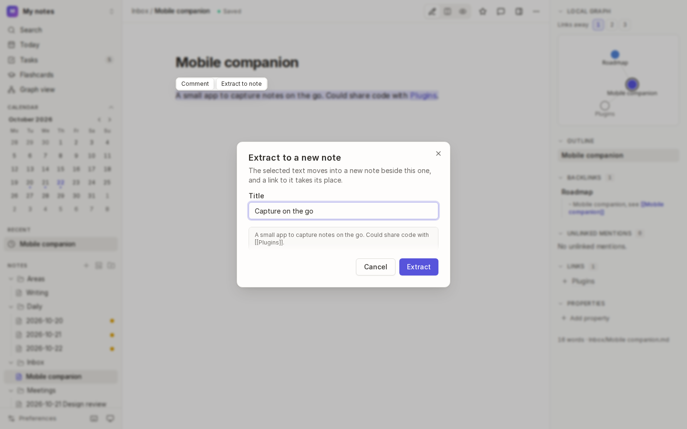
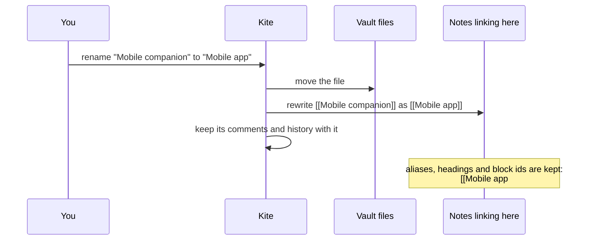
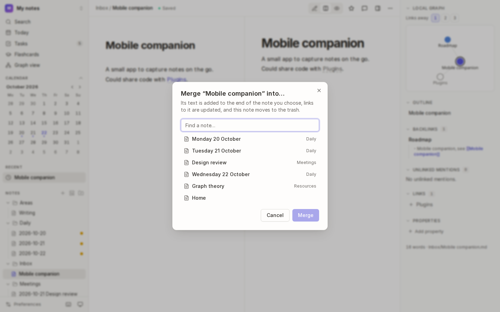

# Reorganising notes

Vaults grow and change shape. Kite lets you rename and move notes and folders, split a long note in two, and merge notes together, and **every link follows**, so nothing breaks.

## How it works

Kite finds every link to the note, in every note, and rewrites just the name part. Aliases (`|the app`), headings (`#Goals`) and block ids (`#^id`) stay as they were. Canvases that show the note are updated too.

## Rename or move a note

- **Click the note's path** in its bar (`Inbox / Mobile companion`), edit it, and press <kbd>Enter</kbd>. Change the name to rename it, or the folder part to move it (`Projects/Mobile app`). New folders are created as needed.
- Or choose **Rename or move** under <kbd>⋯</kbd>.
- Or **drag** the note to another folder in the file tree.

Renamed or moved a note in another app? Kite notices, keeps its history, and links find it by its new name (see [History and recovery](12-history-and-recovery.md)).

## Work with folders

Each folder in the file tree has a menu (rest the pointer on it and choose <kbd>⋯</kbd>):

| Choose | To |
| --- | --- |
| **New note** | create a note in the folder |
| **From template…** | create a note in the folder [from a template](03-daily-notes-and-templates.md#use-a-template) |
| **New folder** | create a folder inside it |
| **Rename…** | rename the folder: every note in it moves, and links follow |
| **Delete…** | delete the folder and everything in it (you'll be asked first) |

The folder button next to **Notes** in the sidebar makes a folder at the top level. Drag notes and folders to move them.

## Extract a selection to a new note

Split a long note by moving part of it into a note of its own:

1. Select the text in the editor.
2. Choose **Extract to note** on the bar that appears above the selection (or **Extract selection to a new note** in the command palette).
3. Give the new note a **Title** and choose **Extract**.

The selected text moves into the new note, in the same folder, and a link to it (`[[Capture on the go]]`) takes its place.

## Merge notes

Combine two notes on the same topic:

1. Open the note you want to merge **away**.
2. Choose **Merge into…** under <kbd>⋯</kbd> (or **Merge into another note…** in the command palette).
3. Pick the note to merge it **into**, and choose **Merge**.

Its text is added to the end of the other note, links to it now point to the other note, and the merged note moves to the trash. It's kept in [Recently deleted](12-history-and-recovery.md#recently-deleted) for 30 days in case you change your mind.

## Favourites and recent notes

- **Star** a note (the ☆ in its bar, or **Add or remove from favourites** in the command palette) to keep it under **Favourites** in the sidebar.
- **Recent** in the sidebar lists the notes you opened last.

## Tips

- **Deleting** a note or folder sends it to your system's trash in the desktop app, and keeps its history in Kite's [Recently deleted](12-history-and-recovery.md#recently-deleted).
- **A note's history moves with it** when you rename or move it, in Kite or in another app.

## See also

- [Links](04-links.md) · [History and recovery](12-history-and-recovery.md)
