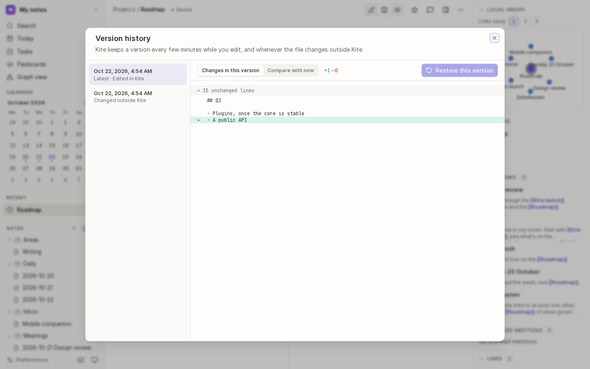
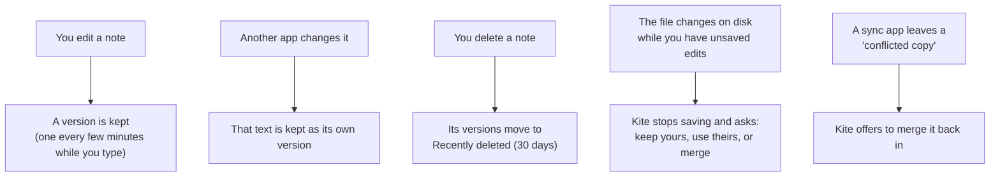
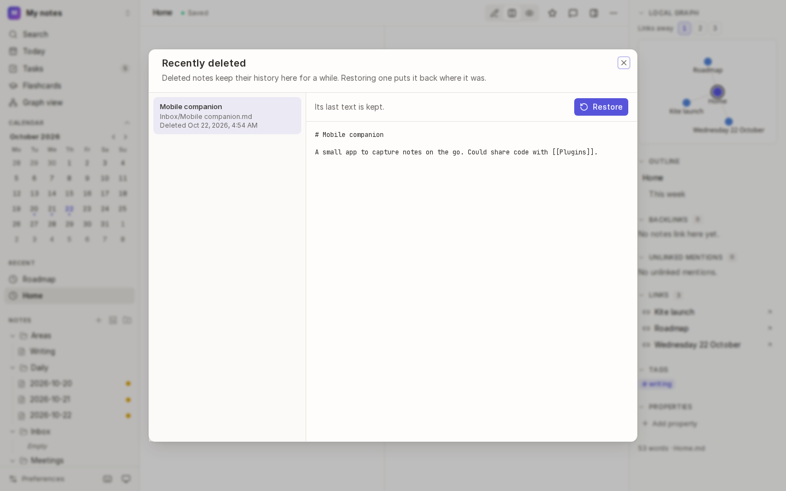
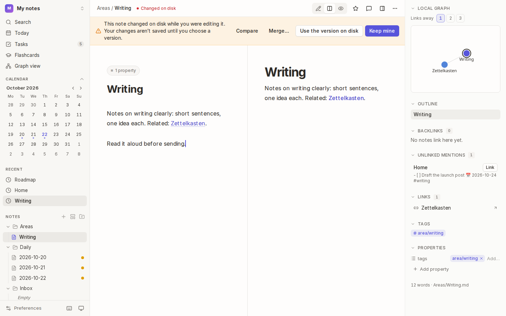
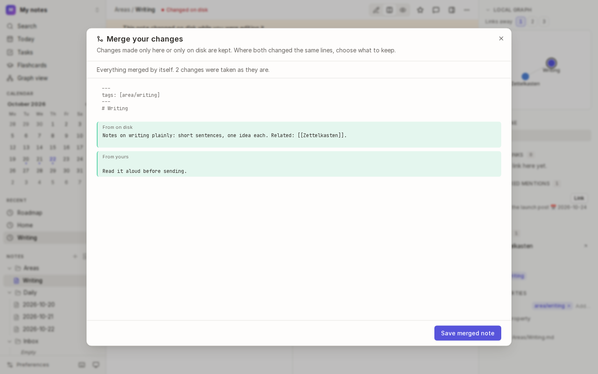
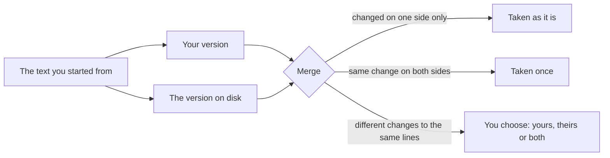
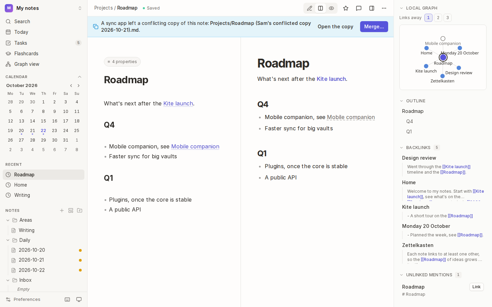

# History and recovery

Kite keeps earlier versions of every note, keeps deleted notes for 30 days, and never lets a save quietly overwrite a change made somewhere else. If something goes wrong, you can almost always get your words back.

## How it works

## Version history

### See and restore earlier versions

1. Open the note and choose **Version history** under <kbd>⋯</kbd> (or **Show version history** in the command palette).
2. Choose a version on the left. Each is labelled with when it was saved and how it came about: **Edited in Kite**, **Changed outside Kite**, **Restored** or **Merged**.
3. See what changed:
   - **Changes in this version** shows what that version added (green) and removed (red).
   - **Compare with now** shows how it differs from the note as it is now.
4. To go back to it, choose **Restore this version**. The text you had is kept as a version too, so restoring can be undone.

### What's kept

- While you type, saves within a few minutes of each other are folded into one version, so history isn't flooded.
- Text written by another app (or from before Kite first saved the note) is kept as its own version the next time Kite sees it.
- Older history is thinned out: every version from the last day, then one an hour for a week, one a day for 90 days, and one a week after that, up to 100 versions a note.
- A [locked note](13-locked-notes.md)'s versions are encrypted like the note itself.

History is kept in Kite's own database, not in the vault, so other apps don't see it.

## Recently deleted

A deleted note keeps its history for 30 days, whether you deleted it in Kite, deleted its folder, or deleted the file in another app.

- **Right after deleting**, choose **Undo** in the message at the bottom of the window.
- **Later**, choose the vault's name at the top of the sidebar, then **Recently deleted…** (or **Show recently deleted notes** in the command palette). Choose a note to read its last text, then **Restore**.

Restoring puts the note back where it was (or beside it, as "Note (restored)", if something else is there now), with its history and star. If a deleted file comes back on its own (say, restored from your system's trash, or a rename seen by a sync tool as a delete and an add), Kite recognises it and gives it its history back.

Change how long deleted notes are kept with `KITE_DELETED_NOTES_KEEP_DAYS`.

## When a note changes in two places at once

If a note's file changes on disk while you have unsaved edits (in another app, a sync, or the other pane), Kite stops saving that note and shows a banner. Nothing is overwritten until you choose:

| Choose | To |
| --- | --- |
| **Compare** | see what differs between the two first |
| **Merge…** | combine them (below) |
| **Use the version on disk** | drop your unsaved edits and take the other version |
| **Keep mine** | save your version over the other one, knowingly (it's still kept in history) |

### Merge two versions

**Merge…** compares both versions with the text they started from:

1. Changes made on only one side are taken automatically, and marked with where they came from.
2. Where both changed the same lines, choose **Yours**, the other version, or **Keep both** for each. **Use yours everywhere** and **Use … everywhere** decide them all at once.
3. Choose **Save merged note**.

## Conflicting copies from sync apps

When a note changes on two devices before they sync, some sync apps keep both, naming one a "conflicted copy". Kite recognises these names:

| App | Copy's name |
| --- | --- |
| Dropbox | `Roadmap (Sam's conflicted copy 2026-10-21).md` |
| Nextcloud, ownCloud, Obsidian Sync | `Roadmap (conflicted copy 2026-10-21 101530).md` |
| Syncthing | `Roadmap.sync-conflict-20261021-101530-ABCD123.md` |

The original note says so in a banner. Choose **Merge…** to compare the copy with the note (every difference is yours to choose, as there's no common starting point), then **Save and delete the copy**. The copy is kept in [Recently deleted](#recently-deleted) in case you need it. A copy itself shows which note it belongs to.

Names other apps might also use, such as `Roadmap 2.md` or `Roadmap (1).md`, aren't treated as copies, as they're just as likely to be notes of your own.

## See also

- [Locked notes](13-locked-notes.md) · [Reorganising notes](11-reorganising-notes.md)
