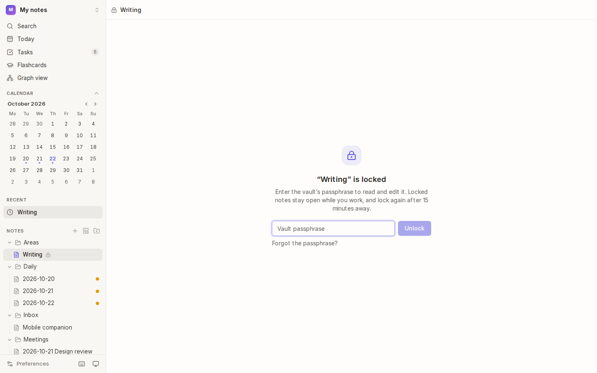
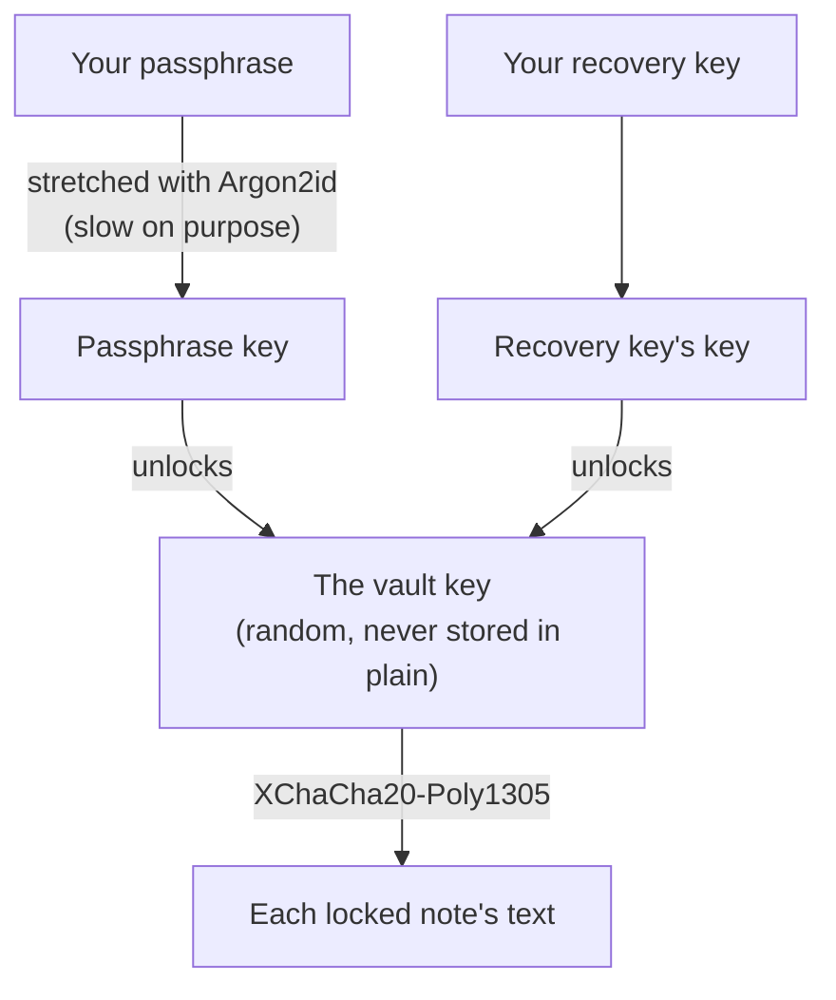

# Locked notes

Lock a note to encrypt it on disk with a passphrase. Anyone who opens the file in another app, gets hold of your backups or reads your synced folder sees only scrambled text. In Kite, you unlock the vault once and locked notes open as usual, until you lock it again or walk away.



## How it works



- One passphrase per vault. It unlocks a random **vault key**, which encrypts every locked note. Changing the passphrase only re-wraps that key, so no note has to be encrypted again.
- A **recovery key** unlocks the same vault key, in case you forget the passphrase.
- The vault key is only ever kept in the window's memory while the vault is unlocked. On disk, `.kite/lock.json` holds it wrapped by each key, never in plain.
- A locked note's **file name** stays readable (that's how it's found). Its title, text, links, tags, tasks and properties are all inside the encryption.

## Lock your first note

1. Open the note and choose **Lock note…** under <kbd>⋯</kbd> (or **Lock or unlock this note** in the command palette).
2. The first time, choose a **passphrase** for the vault (at least 8 characters) and type it again.
3. Kite shows a **recovery key**, such as `7K3M-QX2P-…`. **Save it somewhere safe now** (a password manager, or on paper). It's shown once, and without it a forgotten passphrase means your locked notes are gone for good.
4. The note is encrypted. It shows a lock in the file tree and a **Locked** badge in its bar.

After that, **Lock note…** locks a note straight away, with the same passphrase.

## Open locked notes

1. Open a locked note. Kite asks for the vault's passphrase.
2. Type it and choose **Unlock**. Every locked note in the vault opens until the vault locks again.

The vault locks again:

- after **15 minutes** without typing or clicking,
- when you choose **Lock the vault now** in the command palette,
- when you close or reload the window.

Unsaved edits to a locked note are saved before it locks.

## Manage the passphrase

| To | Choose |
| --- | --- |
| Change the passphrase | **Change the vault passphrase…** in the command palette |
| Make a new recovery key (the old one stops working) | **New recovery key…** in the command palette |
| Unlock with the recovery key | **Forgot the passphrase?** on the unlock screen, then type the recovery key and a new passphrase |
| Stop encrypting a note | open it, then **Remove lock** under <kbd>⋯</kbd> |

Kite allows 10 passphrase tries a minute, to slow down guessing.

## What a locked note gives up

Encryption means Kite can't read a locked note while the vault is locked, so:

- **Search, links, tags and tasks** don't see inside it. It's found by its file name.
- **Embeds and link previews** show that the note is locked, not its text.
- **Export and publishing** aren't available for it.
- **History:** when you lock a note, its plain-text history and its comments are erased (Kite overwrites the database pages too). New versions are encrypted.

## On disk

A locked note's file is still a valid Markdown file, so other apps open it without errors:

~~~markdown
<!-- kite-locked v1 -->
This note is locked. Open it in Kite and enter the vault's passphrase to read it.

```kite-locked
cB3x0Wm…(encrypted text)…
```
~~~

Don't edit the encrypted block: Kite detects any change to it, and the note won't open.

## Tips

- **Test your recovery key** once, with **Forgot the passphrase?**, while you still know the passphrase.
- **Lock notes, not everything:** locking hides a note from search and links, so keep it for what's private.

## See also

- [History and recovery](12-history-and-recovery.md) · [Preferences → Privacy](16-preferences-and-shortcuts.md)
