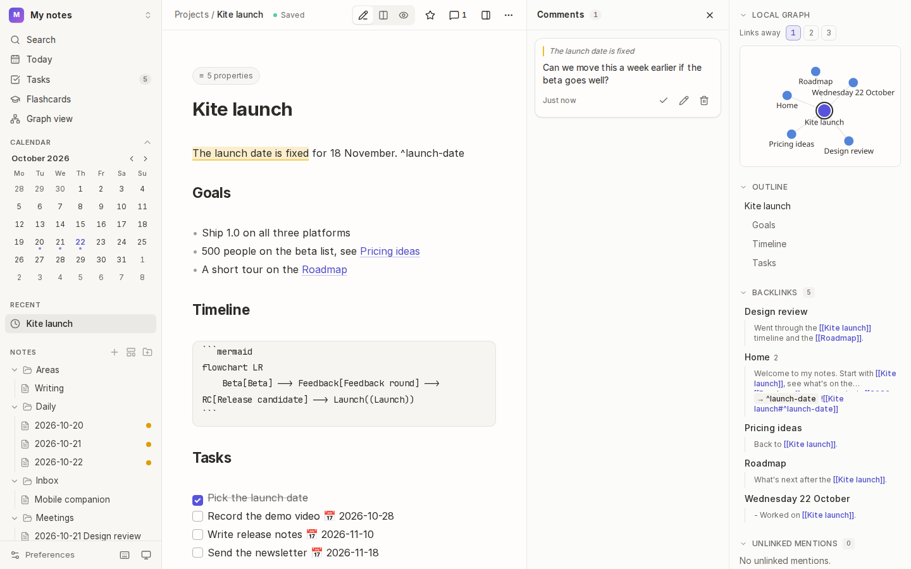
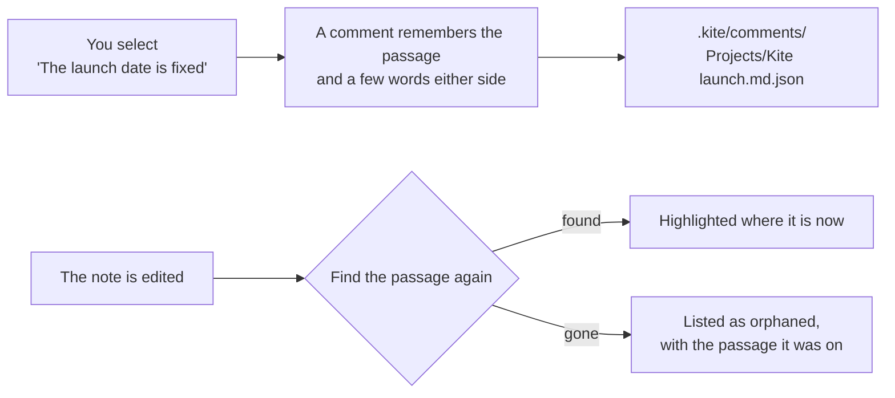

# Comments

Leave a comment on a passage of a note (a question, a reminder, a thought for later) without changing the note itself. Comments sit beside the text they're about, and follow it as the note changes.

## How it works

- Comments are stored in the vault's `.kite/comments/` folder, one file per note, so **your note's text is never touched** and other apps don't see them.
- A comment remembers its passage by its words, not by line number, so it stays attached as you edit around it.
- Comments move with a note when you rename or move it in Kite.

## Comment on a passage

1. Select some text in the editor.
2. Choose **Comment** on the bar that appears above the selection, or press <kbd>Mod</kbd>+<kbd>Alt</kbd>+<kbd>M</kbd>.
3. Type the comment and save it.

The passage is highlighted in the editor, and the comments panel opens beside the note.

## Read and manage comments

- **Open the comments panel** with the speech bubble in the note's bar (it shows how many open comments the note has), or **Toggle comments** in the command palette.
- **Choose a comment** to select its passage in the note, or **click a highlighted passage** to find its comment.
- Each comment has buttons to **resolve** it (✓), **edit** it and **delete** it.
- **Resolved comments** are tucked away under a toggle at the bottom of the panel, in case you need them again.
- **Orphaned comments** are ones whose passage was deleted or changed beyond recognition. They're listed in their own section with the passage they were on, so you can decide what to do with them.

## Tips

- **Comments vs. notes in the text:** use a comment for something about the note (a question for later, a review remark), and the note itself for what you want to keep.
- **Locked notes** can't have comments: locking a note deletes its comments, as they quote its text.

## See also

- [Writing](02-writing.md) · [Locked notes](13-locked-notes.md)
