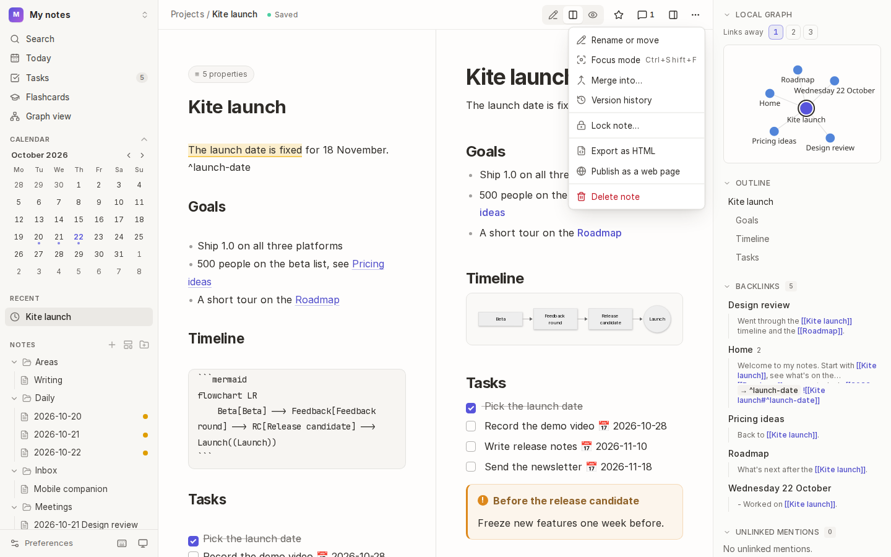
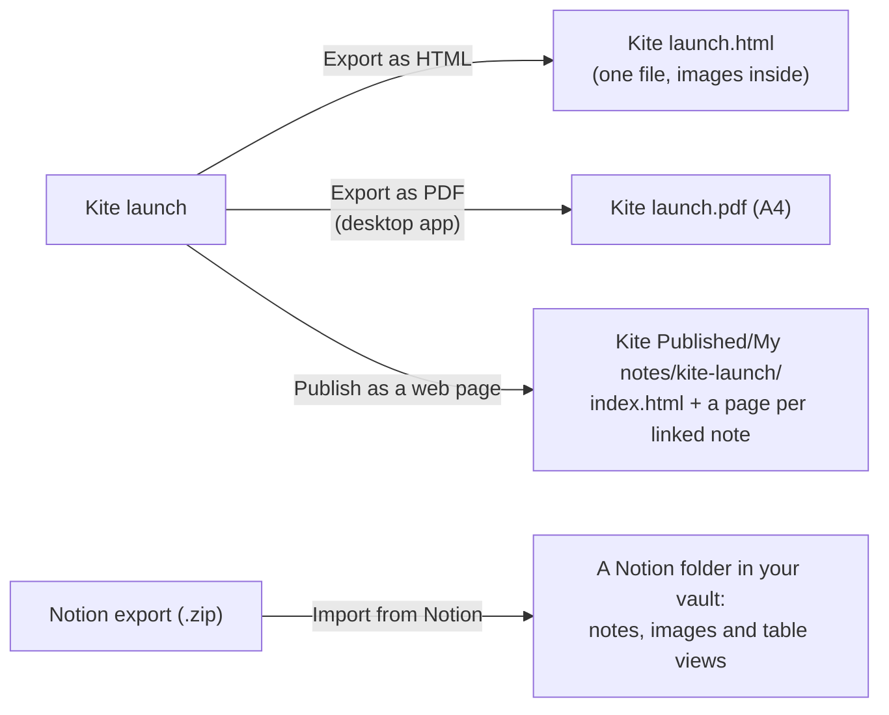
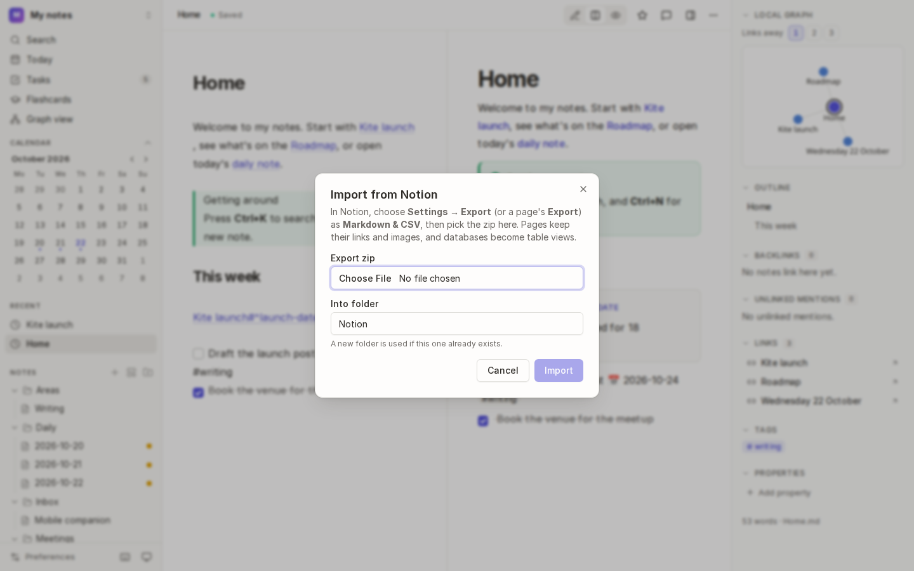

# Sharing and importing

Share a note as a web page or a PDF, publish a note and the notes it links to as a small website, or bring your notes in from Notion.

## How it works

## Export a note

1. Open the note and choose <kbd>⋯</kbd> in its bar.
2. Choose **Export as HTML**, or **Export as PDF** in the desktop app.
3. Save the file.

An **HTML** export is a single file that opens in any browser, offline, with the note's styles and images inside it. Math is shown as its TeX source and diagrams as their Mermaid code, as both are drawn by Kite's preview. Links to other notes become plain text, as those notes aren't included (publish instead, to keep them). A **PDF** is A4, with the same styling.

## Publish a note as a small website

1. Open the note and choose **Publish as a web page** under <kbd>⋯</kbd>.
2. Kite writes the note as `index.html`, plus a page for each note it links to, into a folder in your home folder: `Kite Published/<vault>/<note>`. In the desktop app, the folder opens when it's done.
3. Upload the folder to any static web host (GitHub Pages, Netlify, your own server), or share it as it is.

Links between the published pages work. Publishing the same note again replaces its pages, and nothing else in the folder. Choose where published notes go in [Preferences → Publishing](16-preferences-and-shortcuts.md).

## Import from Notion

1. In Notion, open **Settings → Export** (or a page's **Export**) and export as **Markdown & CSV**. Notion gives you a `.zip` file. Large exports may be split into several zips inside one, and that's fine.
2. In Kite, choose the vault's name at the top of the sidebar, then **Import from Notion…**.
3. Choose the **Export zip**, and the folder to put it **Into** (`Notion` by default; a new folder is used if that one already exists).
4. Choose **Import**.

What you get:

| In Notion | In Kite |
| --- | --- |
| Pages | notes, named without Notion's ids |
| Links between pages | [wiki links](04-links.md) |
| Images and files | attachments, embedded where they were |
| Database rows | notes with their fields as [properties](02-writing.md#properties) |
| Databases | a [table view](07-views-and-tasks.md) of their rows |

Your Notion workspace isn't changed: Kite only reads the export.

## Tips

- **Locked notes** can't be exported or published: their text is encrypted.
- **Printing:** export as HTML, open it in your browser and print, from any version of Kite.

## See also

- [Locked notes](13-locked-notes.md) · [Preferences → Publishing](16-preferences-and-shortcuts.md)
