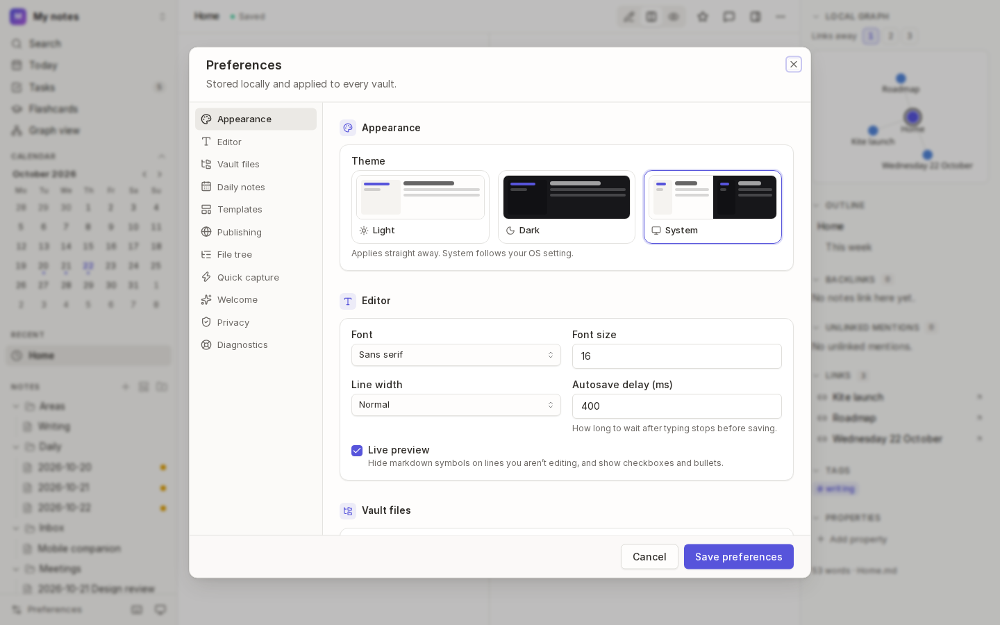
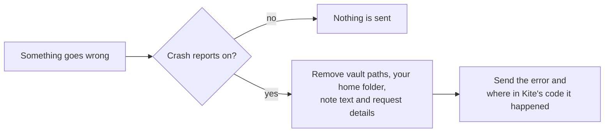
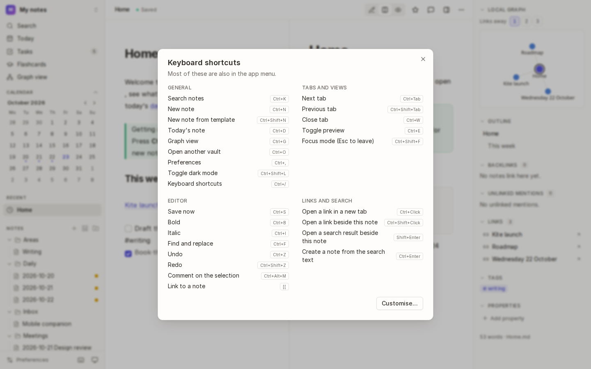
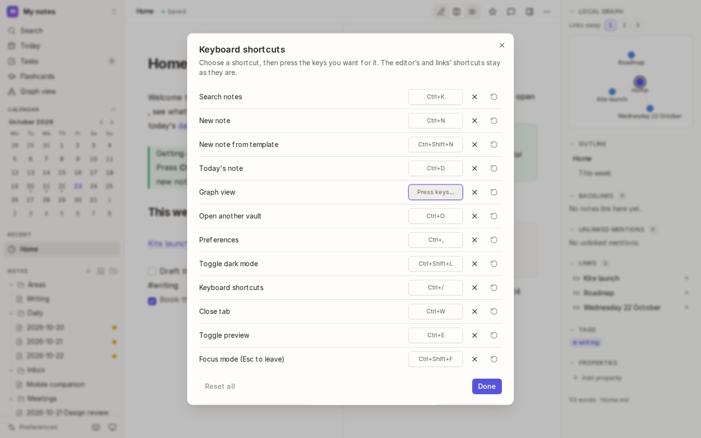
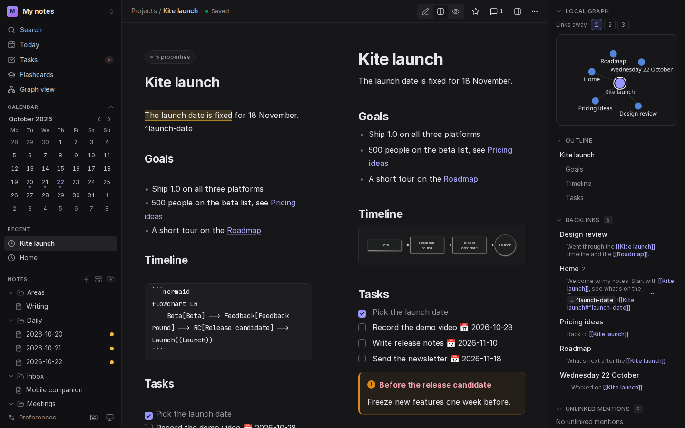

# Preferences and shortcuts

Make Kite look and work the way you like: theme, fonts, where files go, daily notes, templates, the quick capture shortcut and privacy. Preferences are kept on your computer and apply to every vault.

## Open preferences

Press <kbd>Mod</kbd>+<kbd>,</kbd>, or choose **Preferences** at the bottom of the sidebar. Choose a section on the left to jump to it, change what you like, then choose **Save preferences**.

## Every preference

| Section | Setting | Does |
| --- | --- | --- |
| **Appearance** | Theme | **Light**, **Dark**, or **System** to follow your computer. <kbd>Mod</kbd>+<kbd>Shift</kbd>+<kbd>L</kbd> switches between light and dark. |
| **Editor** | Font, Font size | sans serif, serif or monospace, at any size |
| | Line width | how wide the text runs: narrow, normal, wide or full |
| | Autosave delay (ms) | how long after you stop typing a note is saved (400 by default) |
| | Live preview | hide Markdown symbols on lines you aren't editing, and show checkboxes and bullets |
| **Vault files** | Ignored folders | folders Kite leaves out, one per line (`node_modules` by default). Folders starting with a dot, like `.git`, are always ignored. |
| | Attachments folder | where pasted and dropped files are saved (`attachments`) |
| **Daily notes** | Folder, File name format, Template note | see [Daily notes](03-daily-notes-and-templates.md#set-them-up) |
| **Templates** | Templates folder | where templates live (`Templates`). Leave it empty to turn templates off. |
| **Publishing** | Publish folder | where [published notes](15-sharing-and-importing.md#publish-a-note-as-a-small-website) go. Empty means `Kite Published` in your home folder. |
| **File tree** | Colour dots | show each note's [colour group](05-tags-and-colour-groups.md#colour-groups) as a dot in the file tree |
| **Quick capture** | Global shortcut | the [quick capture](03-daily-notes-and-templates.md#quick-capture) key, such as `CmdOrCtrl+Shift+Space`. Leave it empty to turn it off. |
| **Welcome** | Show on startup, What's new after an update | when the [Welcome tab](01-getting-started.md#the-welcome-tab) opens by itself |
| **Privacy** | Crash reports | send a report when something goes wrong (off by default; see below) |
| **Diagnostics** | Copy diagnostics, Open logs | details to paste into a bug report, and Kite's log files |

## Privacy and crash reports

Kite runs entirely on your computer and sends nothing anywhere unless you turn **crash reports** on (Kite asks once, on the Welcome tab). If you do:

A report says what went wrong and where in Kite's code. It **never includes your notes**: their text, titles and folder paths are removed, as are the values Kite was saving or searching for. Turn reports off again in **Preferences → Privacy** at any time.

## Keyboard shortcuts

Press <kbd>Mod</kbd>+<kbd>/</kbd> in Kite for this list. `Mod` is <kbd>⌘</kbd> on macOS and <kbd>Ctrl</kbd> on Windows and Linux. These are the defaults; you can [change most of them](#change-a-shortcut).

### General

| Shortcut | Does |
| --- | --- |
| <kbd>Mod</kbd>+<kbd>K</kbd> | Search notes, and run commands with `>` |
| <kbd>Mod</kbd>+<kbd>N</kbd> | New note |
| <kbd>Mod</kbd>+<kbd>Shift</kbd>+<kbd>N</kbd> | New note from template |
| <kbd>Mod</kbd>+<kbd>D</kbd> | Today's note |
| <kbd>Mod</kbd>+<kbd>G</kbd> | Graph view |
| <kbd>Mod</kbd>+<kbd>O</kbd> | Open another vault |
| <kbd>Mod</kbd>+<kbd>,</kbd> | Preferences |
| <kbd>Mod</kbd>+<kbd>Shift</kbd>+<kbd>L</kbd> | Toggle dark mode |
| <kbd>Mod</kbd>+<kbd>/</kbd> | Keyboard shortcuts |
| <kbd>Ctrl</kbd>+<kbd>Shift</kbd>+<kbd>Space</kbd> | Quick capture, from anywhere (<kbd>⌘</kbd>+<kbd>Shift</kbd>+<kbd>Space</kbd> on macOS) |

### Tabs and views

| Shortcut | Does |
| --- | --- |
| <kbd>Ctrl</kbd>+<kbd>Tab</kbd>, <kbd>Ctrl</kbd>+<kbd>Shift</kbd>+<kbd>Tab</kbd> | Next and previous tab |
| <kbd>Mod</kbd>+<kbd>W</kbd> | Close tab |
| <kbd>Mod</kbd>+<kbd>E</kbd> | Toggle preview |
| <kbd>Mod</kbd>+<kbd>Shift</kbd>+<kbd>F</kbd> | Focus mode (<kbd>Esc</kbd> to leave) |

### Editor

| Shortcut | Does |
| --- | --- |
| <kbd>Mod</kbd>+<kbd>S</kbd> | Save now |
| <kbd>Mod</kbd>+<kbd>B</kbd>, <kbd>Mod</kbd>+<kbd>I</kbd> | Bold, italic |
| <kbd>Mod</kbd>+<kbd>F</kbd> | Find and replace |
| <kbd>Mod</kbd>+<kbd>Z</kbd>, <kbd>Mod</kbd>+<kbd>Shift</kbd>+<kbd>Z</kbd> | Undo, redo |
| <kbd>Mod</kbd>+<kbd>Alt</kbd>+<kbd>M</kbd> | Comment on the selection |
| `[[` | Link to a note |
| `/` | Insert a block (headings, lists, tables…) |

### Links and search

| Shortcut | Does |
| --- | --- |
| <kbd>Mod</kbd>+click | Open a link in a new tab (in the editor, follow it) |
| <kbd>Mod</kbd>+<kbd>Shift</kbd>+click | Open a link beside this note |
| <kbd>Shift</kbd>+<kbd>Enter</kbd> | Open a search result beside this note |
| <kbd>Mod</kbd>+<kbd>Enter</kbd> | Create a note from the search text |

### Change a shortcut

The shortcuts under **General** and **Tabs and views** (all but next and previous tab) can be changed, or turned off.

1. Press <kbd>Mod</kbd>+<kbd>/</kbd> and choose **Customise…**.
2. Choose the shortcut you want to change, then press the new keys. A shortcut is <kbd>Mod</kbd> with a letter, number or punctuation key, plus <kbd>Alt</kbd> or <kbd>Shift</kbd> if you like. Press <kbd>Esc</kbd> to keep the old one.
3. Choose **×** to turn a shortcut off, or **↺** to put it back as it was. **Reset all** puts every one back.

Kite won't take a shortcut that's already in use, by another command or by the editor (such as <kbd>Mod</kbd>+<kbd>B</kbd> for bold); it says what uses it. New shortcuts work straight away, show in the menus and the command palette, and apply to every vault. The editor's own shortcuts, and those for links and search, stay as they are.

## Accessibility

- **Light and dark themes** both meet WCAG AA contrast.
- **Everything works from the keyboard:** arrow keys move through the file tree, a skip link jumps to the note, and every control has a label for screen readers. Kite is checked with axe on every page.
- **Reduced motion:** if your system asks for less motion, the graph settles without animating and smooth scrolling is turned off.

## See also

- [Getting started](01-getting-started.md) · [Search and commands](06-search.md)
