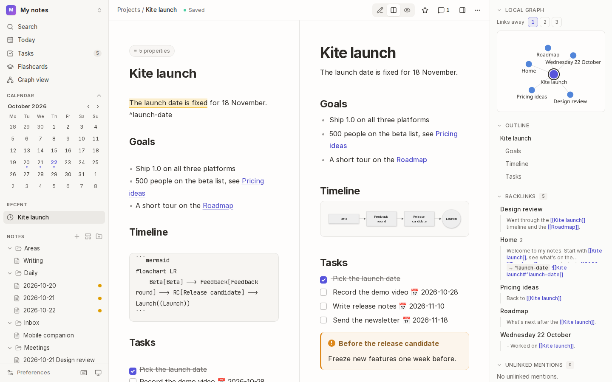

# Kite user manual

Everything Kite does, one feature at a time: what it's for, how it works, and how to use it, step by step. New to Kite? Start with **Getting started**, then dip into whatever you need.



## Contents

| | Page | What's in it |
| --- | --- | --- |
| 🪁 | [Getting started](01-getting-started.md) | Opening a vault, finding your way around, the Welcome tab, your vault on disk |
| ✍️ | [Writing](02-writing.md) | The editor and live preview, view modes, focus mode, tabs, `/` commands, callouts, math, diagrams, attachments, properties |
| 📅 | [Daily notes, templates and quick capture](03-daily-notes-and-templates.md) | A note a day, templates with placeholders, capturing a thought from anywhere |
| 🔗 | [Links](04-links.md) | Wiki links, headings and blocks, embeds, link previews, backlinks and unlinked mentions |
| 🏷️ | [Tags and colour groups](05-tags-and-colour-groups.md) | Tags and nested tags, tag pages, colouring notes by a rule |
| 🔎 | [Search and commands](06-search.md) | The command palette, search filters, saved searches |
| 📋 | [Views and tasks](07-views-and-tasks.md) | Table and board views of your notes' properties, every task in one place |
| 🕸️ | [Graph](08-graph.md) | The graph of your whole vault, and each note's local graph |
| 🧩 | [Canvases](09-canvases.md) | A whiteboard of cards, notes, links and flowchart shapes, with arrows your way |
| 🧠 | [Flashcards](10-flashcards.md) | Writing cards in your notes and studying them with spaced repetition |
| 🗂️ | [Reorganising notes](11-reorganising-notes.md) | Renaming, moving, folders, extracting and merging, with links that follow |
| 🕰️ | [History and recovery](12-history-and-recovery.md) | Version history, recently deleted notes, merging changes, sync apps' conflicting copies |
| 🔒 | [Locked notes](13-locked-notes.md) | Encrypting notes with a passphrase, and the recovery key |
| 💬 | [Comments](14-comments.md) | Comments on passages of a note |
| 📤 | [Sharing and importing](15-sharing-and-importing.md) | Exporting to HTML or PDF, publishing a small website, importing from Notion |
| ⚙️ | [Preferences and shortcuts](16-preferences-and-shortcuts.md) | Every preference, privacy and crash reports, every keyboard shortcut and how to change them, accessibility |

## Conventions

- `Mod` means <kbd>⌘</kbd> on macOS and <kbd>Ctrl</kbd> on Windows and Linux.
- **Bold** names a button, menu item or command, as it appears in Kite.
- <kbd>⋯</kbd> is the **More** menu at the right of a note's bar.
- Most things can also be done from the command palette: press <kbd>Mod</kbd>+<kbd>K</kbd>, type `>` and the command's name.

## About the screenshots

The screenshots are taken of a demo vault by Kite's own test suite, so they can be brought up to date whenever the app changes:

```bash
bun run build
php artisan test --testsuite=Manual
```

That writes the images into [`images/`](images). The demo vault is in [`tests/Support/DemoVault.php`](../../tests/Support/DemoVault.php).
